# Báo Cáo Tổng Hợp Dự Án: TOEIC Flashcard (`com.toeicflashcard`)

> **TOEIC Flashcard** là ứng dụng học từ vựng TOEIC đa giác quan chạy hoàn toàn ngoại tuyến (**offline-first**) trên Android, tích hợp **4 kho học liệu với 2.154 từ vựng across 104 chủ đề** (+ kho **Từ vựng tự thêm** qua nhập tay hoặc file JSON), thuật toán lặp lại ngắt quãng **SuperMemo-2 (SM-2)**, hệ thống **Daily Streak & Biểu đồ 7 ngày**, **Trắc nghiệm nhanh & Luyện nghe phản xạ TTS**, **WorkManager Daily Reminder**, ngôn ngữ giao diện **Apple Liquid Glass** hỗ trợ **7 không gian học tập tối (Dark Presets)** cùng **thanh trượt độ đục kính thời gian thực**, và tối ưu **120Hz Adaptive Refresh Rate (ARR)**.

---

## 1. Tổng Quan Dự Án & Thông Số Kỹ Thuật

| Thuộc tính | Giá trị thực tế trong mã nguồn |
| --- | --- |
| **Tên ứng dụng / Application ID** | `TOEIC Flashcard` / `com.toeicflashcard` |
| **Phiên bản Android hỗ trợ** | `minSdk = 24` (Android 7.0) — `targetSdk = 35` — `compileSdk = 35` (JVM 17) |
| **Ngân hàng từ vựng (4 Assets + Custom)** | **2.154 từ vựng** thuộc **104 chủ đề** (`30 + 745` Cốt Lõi `775` • `600` từ *600 Essential Words* • `779` từ *800 Từ TOEIC Level 450*) + từ tự thêm ID `>= 3001` |
| **Điều hướng & Màn hình chính** | **4 Tab Dock nổi** (`Trang chủ`, `Kho từ`, `Luyện tập`, `Thống kê`) + **Overlay Warm NavHost** (`StudyRoute`, `QuizRoute`) |
| **Ngôn ngữ thiết kế** | **Apple Liquid Glass** (`dev.chrisbanes.haze:haze:1.0.0`), Light Ice Mesh + **7 Dark Presets** + **Real-time Glass Opacity Slider** |
| **Hiệu năng & Tần số quét** | **120Hz Adaptive Refresh Rate** (`preferredDisplayModeId`, `isFrameRatePowerSavingsBalanced = true` trên API 35+, 0 infinite idle animation) |
| **Quy mô mã nguồn Kotlin** | **65 file** mã nguồn chính + **9 file** unit test = **74 file** |
| **Kiểm thử tự động & Thực tế** | **38/38 Unit Tests Pass** (`9` test suites, `0` failures/errors); xác minh trên **TECNO CLA5** (Android 16), `120.00001Hz` (`8.33ms` VSYNC), `logcat` `0` crash |

### Lộ trình tiến hóa kiến trúc & tính năng của dự án

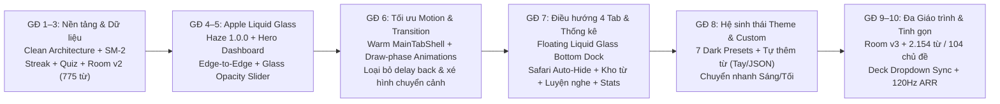

---

## 2. Công Nghệ & Thư Viện Sử Dụng (Tech Stack)

| Nhóm công nghệ | Công nghệ / Thư viện | Phiên bản | Vai trò trong hệ thống |
| --- | --- | --- | --- |
| **Build System** | Gradle Wrapper / Android Gradle Plugin | `8.11.1` / `8.7.3` | Quản lý biến thể `debug`, `release`, `benchmark` và KSP |
| **Ngôn ngữ & UI** | Kotlin + Jetpack Compose BOM + Material 3 + `material-icons-extended` | `2.0.21` / `2024.12.01` | UI khai báo, `LazyColumn`, animation 3D (`graphicsLayer`), in-window frosted sheets/dialogs |
| **Glassmorphism** | `dev.chrisbanes.haze:haze` + `LocalGlassOpacity` | `1.0.0` | Làm mờ thời gian thực cố định (`hazeChild`, `16.dp..20.dp`) trên Header, Dock, Dialog, Sheet |
| **Annotation & JSON** | Google KSP + `kotlinx-serialization-json` | `2.0.21-1.0.28` / `1.7.3` | Sinh code Room DAO, parse 4 file seed JSON, import JSON tùy chỉnh & Type-safe Nav routes |
| **Điều hướng** | `androidx.navigation:navigation-compose` | `2.8.5` | Type-safe routing với `HomeRoute`, `StudyRoute(topic, hardWordsOnly, deckId)`, `QuizRoute(topic, listeningMode, deckId)` |
| **Lưu trữ cục bộ** | Room SQLite (`room-runtime`, `room-ktx`, `KSP`) + DataStore Preferences | `2.6.1` / `1.1.1` | Lưu 2.154+ từ vựng & lịch SM-2 (`ToeicDatabase v3`) và `13` khóa cấu hình DataStore |
| **Xử lý bất đồng bộ** | Kotlin Coroutines (`kotlinx-coroutines-android`) + `Flow` / `StateFlow` / `SharedFlow` | `1.9.0` | Truy vấn/nhóm thống kê nền trên `Dispatchers.Default` & `Dispatchers.IO`, cache đồng bộ giảm 0ms loading flash |
| **Tác vụ nền** | `androidx.work:work-runtime-ktx` | `2.10.0` | `DailyReminderWorker` lập lịch nhắc học định kỳ mỗi 24 giờ và đẩy Notification |
| **Âm thanh ngoại tuyến** | Android SDK `TextToSpeech` (`TtsManager`) | SDK Built-in | Lazy off-main-thread init, phát âm Anh-Mỹ (`Locale.US` -> `Locale.ENGLISH`), tốc độ `0.75x` / `0.95x` |
| **Kiểm thử** | JUnit 4 + `kotlinx-coroutines-test` + `uiautomator` / ADB | `4.13.2` / `1.9.0` | 38 unit tests + xác minh `MIGRATION_2_3`, `dumpsys display`, `SurfaceFlinger --latency`, `gfxinfo` |

---

## 3. Kiến Trúc Hệ Thống & Danh Mục Mã Nguồn

Ứng dụng áp dụng mô hình **Clean Architecture 3 tầng** kết hợp **MVVM** và **Manual Dependency Injection** qua [AppContainer.kt](file:///d:/cv/project/Test_appAndroid/app/src/main/java/com/toeicflashcard/di/AppContainer.kt), tách biệt hoàn toàn quy tắc nghiệp vụ khỏi Android SDK.

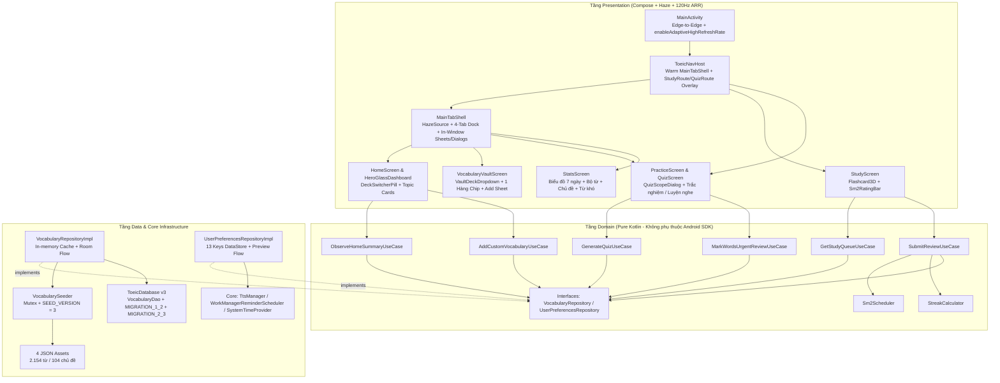

### Cấu trúc toàn bộ 65 file mã nguồn chính & 9 file test (`com.toeicflashcard`)

- **App Entry & DI (`3` files):**
  - `MainActivity.kt` (Edge-to-edge, quan sát theme/darkTone/opacity, cấu hình `enableAdaptiveHighRefreshRate` + ARR API 35+)
  - `ToeicApplication.kt` & `di/AppContainer.kt` (khởi tạo singleton database, seeder, repositories, schedulers và use cases)
- **`core/` (`11` files):**
  - `core/audio/TtsManager.kt`: Lazy TTS engine trên `Executors.newSingleThreadExecutor()`, queue từ chờ khi engine đang khởi động, fallback `Locale.US -> Locale.ENGLISH`.
  - `core/notification/ReminderNotificationHelper.kt`, `ReminderScheduler.kt`: Tạo notification channel và lập lịch WorkManager mỗi 24h.
  - `core/time/TimeProvider.kt`: `SystemTimeProvider` chuẩn hóa `epochDay` và `endOfTodayMillis` an toàn từ API 24+.
  - `core/ui/theme/Color.kt`, `Theme.kt`, `Type.kt`: Hệ thống `LocalLiquidGlassColors`, `LocalDarkTone`, `LocalGlassOpacity`, `LocalSm2RatingColors`, Material 3 color schemes động theo `DarkTone`.
  - `core/ui/glass/AmbientMeshBackground.kt`, `LiquidGlassComponents.kt`, `LiquidGlassBottomDock.kt`, `CollapsibleHeaderState.kt`: Nền tĩnh (Light bitmap mesh rasterized 1 lần mỗi Viewport / Dark đơn sắc theo preset), thẻ/nút/dialog/sheet kính, `LiquidGlassHairlineProgress`, `LiquidGlassSearchCapsule` (hỗ trợ `hazeChild` floating pill), `CollapsibleHeaderState`, và `LiquidGlassBottomDock` + `DockScrollController`.
- **`data/` (`10` files):**
  - `data/local/entity/VocabularyEntity.kt`, `data/local/dao/VocabularyDao.kt`: Bảng `vocabulary_words` với 3 index (`topic`, `nextReviewTimestamp`, `deckId`), `Insert(IGNORE)` cho seed và `Insert(ABORT)` cho từ tự thêm.
  - `data/local/database/ToeicDatabase.kt`, `VocabularySeeder.kt`: Room v3 (`MIGRATION_1_2`, `MIGRATION_2_3`), Seeder v3 với `Mutex` đồng bộ `ASSET_FILES`.
  - `data/local/preferences/UserPreferencesDataStore.kt`, `data/repository/UserPreferencesRepositoryImpl.kt`: Lưu 13 khóa DataStore an toàn atomic (`edit`) và `MutableStateFlow` preview độ đục kính thời gian thực.
  - `data/mapper/VocabularyMapper.kt`, `data/model/SeedVocabularyDto.kt`, `data/repository/VocabularyRepositoryImpl.kt`, `data/worker/DailyReminderWorker.kt`.
- **`domain/` (`16` files):**
  - `domain/model/`: `VocabularyWord.kt` (`VocabularyDecks`, `DeckProgress`), `UserPreferences.kt` (`ThemeMode`, `DarkTone` 7 presets), `HomeSummary.kt`, `TopicProgress.kt`, `QuizModels.kt`, `ReviewQuality.kt`, `Sm2Result.kt`.
  - `domain/scheduler/Sm2Scheduler.kt`, `domain/streak/StreakCalculator.kt`.
  - `domain/repository/`: `VocabularyRepository.kt`, `UserPreferencesRepository.kt`.
  - `domain/usecase/`: `ObserveHomeSummaryUseCase.kt`, `GetStudyQueueUseCase.kt`, `SubmitReviewUseCase.kt`, `GenerateQuizUseCase.kt`, `MarkWordsUrgentReviewUseCase.kt`, `AddCustomVocabularyUseCase.kt`.
- **`presentation/` (`25` files):**
  - `presentation/navigation/ToeicNavHost.kt` & `presentation/main/MainTabShell.kt`: Giữ warm `MainTabShell` khi đẩy `StudyRoute` / `QuizRoute` để Back về 0ms delay.
  - `presentation/home/`: `HomeScreen.kt`, `HomeUiState.kt`, `HomeViewModel.kt`, `TopicVisuals.kt` (map 100% 104 chủ đề), cùng các components `HeroGlassDashboard.kt`, `DeckSwitcherSheet.kt`, `AddVocabularySheet.kt`, `QuizScopeDialog.kt`, `ReminderSettingsSheet.kt`.
  - `presentation/vault/`: `VocabularyVaultScreen.kt`, `VocabularyVaultViewModel.kt`.
  - `presentation/practice/`: `PracticeScreen.kt`.
  - `presentation/stats/`: `StatsScreen.kt`, `StatsViewModel.kt`.
  - `presentation/study/`: `StudyScreen.kt`, `StudyUiState.kt`, `StudyViewModel.kt`, `components/Flashcard3D.kt`, `components/Sm2RatingBar.kt`.
  - `presentation/quiz/`: `QuizScreen.kt`, `QuizUiState.kt`, `QuizViewModel.kt`.
- **Unit Tests (`9` files, `38` test cases):**
  - `DisplayRefreshRateSelectionTest.kt`, `SeedVocabularyParsingTest.kt`, `DarkTonePreferencesTest.kt`, `GlassOpacityPreferencesTest.kt`, `Sm2SchedulerTest.kt`, `StreakCalculatorTest.kt`, `AddCustomVocabularyUseCaseTest.kt`, `GenerateQuizUseCaseTest.kt`, `GetStudyQueueUseCaseTest.kt`.

---

## 4. Danh Mục 12 Nhóm Tính Năng Đã Triển Khai

### 4.1. Hệ thống Đa Giáo Trình (2.154 từ / 104 chủ đề) & `DeckSwitcherSheet`
- 4 nguồn học liệu có thể chuyển đổi tức thì qua **Deck Dropdown Switcher** (`DeckSwitcherPill` trên Trang chủ & `VaultDeckDropdownPill` trên Kho từ) mở chung bottom sheet [DeckSwitcherSheet.kt](file:///d:/cv/project/Test_appAndroid/app/src/main/java/com/toeicflashcard/presentation/home/components/DeckSwitcherSheet.kt):

| `deckId` | Tên bộ từ (`deckName`) | Quy mô | Phân bổ ID / Chủ đề |
| --- | --- | :---: | --- |
| `ALL` | **Tất cả bộ từ** | **2.154+ từ** | Tổng hợp mọi giáo trình + từ tự thêm (`104+` chủ đề) |
| `essential_600` | **600 Essential Words** | **600 từ** | ID `1001..1600`, `50` chủ đề (`L01 • Contracts` .. `L50 • Pharmacy`, mỗi bài `12` từ) |
| `level_450_800` | **800 Từ TOEIC Level 450** | **779 từ** | ID `2001..2779`, `18` chủ đề (`Part 1`, `Part 2`, `Part 3`, `Part 5-6`) |
| `core_775` | **TOEIC Cốt Lõi (775)** | **775 từ** | ID `1..775`, `36` chủ đề TOEIC cốt lõi ban đầu (`30 + 745` từ) |
| `custom_user` | **Từ vựng tự thêm** | Động | ID `>= 3001` (và ID cũ `776..1000` được gán khi migrate DB v2 → v3) |

- Trạng thái `selectedDeckId` lưu bền vững trong DataStore và đồng bộ hai chiều giữa **Trang chủ**, **Kho từ vựng**, **Luyện tập**, **Phiên học Flashcard** và **Quiz**.

### 4.2. Điều hướng Floating Liquid Glass Dock & `DockScrollController`
- [LiquidGlassBottomDock.kt](file:///d:/cv/project/Test_appAndroid/app/src/main/java/com/toeicflashcard/core/ui/glass/LiquidGlassBottomDock.kt): Thanh dock dạng viên thuốc lơ lửng phía trên `navigationBarsPadding() + 12.dp`, kính mờ `hazeChild(blurRadius = 18.dp)` với 4 tab: **Trang chủ**, **Kho từ**, **Luyện tập**, **Thống kê**.
- **Safari / Facebook Auto-Hide:** Theo dõi cuộn qua `NestedScrollConnection` (ngưỡng `-24f`/`+16f`), ẩn/hiện mượt bằng spring physics thuần trên Draw-phase (`graphicsLayer { translationY; alpha; scaleX; scaleY }`, **0 recomposition**) và tự động hiện lại khi chạm cuối danh sách hoặc mở màn hình con/sheet.

### 4.3. Trang chủ (`HomeScreen`) & Hero Glass Dashboard
- `FloatingGlassHomeHeader` tối giản chỉ gồm **DeckSwitcherPill** bên trái (tên giáo trình + `SM-2 • X từ • Y chủ đề` + chevron `▾`), **2 nút tròn** bên phải (**Cài đặt** & **Chuyển nhanh Sáng/Tối**), và thanh tìm kiếm `LiquidGlassSearchCapsule` lọc theo tên tiếng Anh & phụ đề tiếng Việt của `TopicVisuals`.
- [HeroGlassDashboard.kt](file:///d:/cv/project/Test_appAndroid/app/src/main/java/com/toeicflashcard/presentation/home/components/HeroGlassDashboard.kt): Hiển thị số từ đến hạn ôn hôm nay trong bộ từ đang chọn, tiến độ đã thuộc (`learnedCount / totalCount`), vòng tròn `CircularProgressIndicator` (`4.dp`) mục tiêu ngày (`5`, `10`, `20` từ), huy hiệu Streak và nút CTA **"Ôn tập ngay"** (tối đa `20` từ/phiên).
- Danh sách `TopicGlassCard` hỗ trợ tiêu đề tối đa 2 dòng (không cắt chữ với tên bài dài), thanh tiến độ hairline `2.dp` sát cạnh dưới, và trạng thái rỗng thân thiện khi chọn bộ từ chưa có từ (`custom_user`).

### 4.4. Kho Từ Vựng Tinh Gọn (`VocabularyVaultScreen`)
- Header trên Tab Kho từ đặt nút **Dropdown kính mờ** (`VaultDeckDropdownPill` hiển thị dạng `Tất cả bộ từ (2.154) ▾`) ngay dưới tiêu đề, tập trung nút `+` (**Thêm từ vựng mới**) ở góc phải, bên dưới là thanh tìm kiếm (`word`, `meaningVi`, `topic`, `phonetic`, `deckName`) và **duy nhất 1 hàng chip lọc trạng thái**: `Tất cả`, `Hay quên`, `Đang học`, `Đã thuộc`.
- Chạm vào mỗi `VaultWordCard` để mở rộng mượt panel câu ví dụ song ngữ Anh–Việt kèm nút phát âm trực tiếp và nhãn giáo trình ngắn (`Cốt lõi 775`, `600 Essential`, `800 Level 450`, `Tự thêm`).

### 4.5. Tự Thêm Từ Vựng Mới (`AddVocabularySheet`)
- [AddVocabularySheet.kt](file:///d:/cv/project/Test_appAndroid/app/src/main/java/com/toeicflashcard/presentation/home/components/AddVocabularySheet.kt) & [AddCustomVocabularyUseCase.kt](file:///d:/cv/project/Test_appAndroid/app/src/main/java/com/toeicflashcard/domain/usecase/AddCustomVocabularyUseCase.kt):
  - **Tab Nhập tay:** Nhập từ vựng, phiên âm IPA (tự chuẩn hóa `/.../`), loại từ (`n.`, `v.`, `adj.`, `adv.`, `phr.`, ...), nghĩa tiếng Việt, chủ đề (chọn gợi ý có sẵn hoặc tự tạo mới, mặc định `"Từ vựng của tôi"`), câu ví dụ Anh–Việt.
  - **Tab Import JSON:** Mở tệp `.json` qua SAF (`ActivityResultContracts.OpenDocument`), tự bóc BOM `\uFEFF`, bỏ qua trùng lặp DB/trong file và các dòng thiếu trường bắt buộc, trả về báo cáo chi tiết số từ đã thêm / trùng / lỗi.
  - Mọi từ tự thêm được cấp phát ID tăng dần từ `MIN_CUSTOM_ID_BASE = 3000` (`max(getMaxWordId(), 3000) + 1`), gán `deckId = "custom_user"`, `nextReviewTimestamp = nowMillis` để xuất hiện ngay trong hàng đợi ôn hôm nay.

### 4.6. Flashcard 3D & Phát Âm Ngoại Tuyến (`StudyScreen` & `Flashcard3D`)
- [Flashcard3D.kt](file:///d:/cv/project/Test_appAndroid/app/src/main/java/com/toeicflashcard/presentation/study/components/Flashcard3D.kt): Hiệu ứng lật 3D bằng `graphicsLayer { rotationY; cameraDistance = 14f * density }` với `tween(480ms, FastOutSlowInEasing)`. Mặt trước hiển thị chủ đề, loại từ, từ vựng, IPA, nút loa; mặt sau hiển thị nghĩa tiếng Việt và khung ví dụ song ngữ (có nút loa đọc ví dụ).
- Hỗ trợ chuyển tốc độ đọc `1.0x` (`0.95f`) / `0.75x`, đọc cache đồng bộ khi mở phiên học (0ms nhấp nháy spinner), tự chuyển sang chế độ **Ôn luyện tự do** khi chạm vào chủ đề chưa có từ đến hạn.

### 4.7. Thuật Toán SM-2 & Hệ Thống Daily Streak
- `Sm2RatingBar` xuất hiện sau khi người học lật mặt sau thẻ lần đầu tiên, kèm nhãn xem trước khoảng lặp (`< 1 ngày`, `1 ngày`, `6 ngày`, `N tháng`/`năm`):
  - **Quên** ($q = 1$), **Khó** ($q = 3$), **Bình thường** ($q = 4$), **Dễ** ($q = 5$).
- Công thức SM-2 chuẩn hóa trong [Sm2Scheduler.kt](file:///d:/cv/project/Test_appAndroid/app/src/main/java/com/toeicflashcard/domain/scheduler/Sm2Scheduler.kt):
  $$EF' = \max\!\left(1.3,\; EF + 0.1 - (5 - q)\bigl(0.08 + 0.02(5 - q)\bigr)\right)$$
  $$I(n) = \begin{cases} 1 \text{ (đẩy về cuối hàng đợi phiên hiện tại)}, & \text{nếu } q < 3 \\ 1 \text{ ngày}, & \text{nếu } q \ge 3 \text{ và } n = 0 \\ 6 \text{ ngày}, & \text{nếu } q \ge 3 \text{ và } n = 1 \\ \operatorname{round}(I(n-1) \times EF') \text{ ngày}, & \text{nếu } q \ge 3 \text{ và } n \ge 2 \end{cases}$$
- [StreakCalculator.kt](file:///d:/cv/project/Test_appAndroid/app/src/main/java/com/toeicflashcard/domain/streak/StreakCalculator.kt): Tăng chuỗi +1 nếu ôn liên tiếp qua ngày hôm sau, giữ nguyên chuỗi và tăng `dailyReviewedCount` trong ngày, ghi lịch sử `14` ngày gần nhất vào DataStore (`daily_review_history`).

### 4.8. Trung Tâm Luyện Tập (`PracticeScreen`), Trắc Nghiệm & Luyện Nghe (`QuizScreen`)
- [PracticeScreen.kt](file:///d:/cv/project/Test_appAndroid/app/src/main/java/com/toeicflashcard/presentation/practice/PracticeScreen.kt): Cung cấp 2 chế độ làm bài tối đa **10 câu** trong phạm vi bộ từ đang chọn (hoặc chọn từng chủ đề qua [QuizScopeDialog.kt](file:///d:/cv/project/Test_appAndroid/app/src/main/java/com/toeicflashcard/presentation/home/components/QuizScopeDialog.kt)):
  1. **Trắc nghiệm nhanh:** Hiện từ + IPA + loa, chọn 1 trong 4 nghĩa tiếng Việt, tự chuyển câu sau `1.200ms`.
  2. **Luyện nghe từ vựng (`listeningMode = true`):** Ẩn mặt chữ tiếng Anh & phiên âm, tự động phát âm qua TTS để rèn phản xạ nghe trước khi mở đáp án; tự chuyển sau `1.600ms`.
- Màn hình tổng kết thống kê tỷ lệ đúng, danh sách từ sai kèm loa phát âm, và nút **"Đưa các từ sai vào diện ôn tập gấp"** (`nextReviewTimestamp = nowMillis`).

### 4.9. Thống Kê Học Tập (`StatsScreen` & `StatsViewModel`)
- [StatsScreen.kt](file:///d:/cv/project/Test_appAndroid/app/src/main/java/com/toeicflashcard/presentation/stats/StatsScreen.kt) tổng hợp 4 thẻ kính toàn diện:
  1. **Tiến độ 7 ngày gần nhất:** Biểu đồ cột vẽ trực tiếp trên Canvas (đường nét đứt mục tiêu ngày, đối chiếu cả lịch sử DataStore lẫn timestamp Room).
  2. **Tiến độ theo Giáo trình / Bộ từ:** Từng giáo trình (`600 Essential Words`, `800 Từ TOEIC Level 450`, `TOEIC Cốt Lõi (775)`, `Từ vựng tự thêm` khi có từ) kèm số từ cần ôn & phần trăm thuộc.
  3. **Tỷ lệ thuộc theo 8 nhóm chủ đề lớn:** *Kinh doanh & Văn phòng*, *Tài chính & Kế toán*, *Nhân sự & Tuyển dụng*, *Tiếp thị & Khách hàng*, *Sản xuất, Vận tải & Du lịch*, *Đời sống & Công trình*, *Luyện Nghe Part 1–3 (TOEIC 450)*, *Luyện Đọc Part 5–6 (TOEIC 450)* (+ *Chủ đề tự tạo* nếu có).
  4. **Nhóm từ khó nhớ nhất:** Top 8 từ có `easeFactor` thấp nhất, hiển thị huy hiệu `EF`, nút loa và nút **"Ôn lại nhóm từ khó"** mở thẳng phiên học SM-2.

### 4.10. Hệ Thống 7 Không Gian Học Tập Tối (7 Dark Presets) & Độ Đục Kính
- Cấu trúc `enum class DarkTone` trong [UserPreferences.kt](file:///d:/cv/project/Test_appAndroid/app/src/main/java/com/toeicflashcard/domain/model/UserPreferences.kt) cung cấp đầy đủ token phân tầng độ sáng (Nền đơn sắc -> Thẻ kính -> Sheet/Dialog -> Chữ chính -> Chữ phụ -> Accent -> Viền sáng) chống lóa chữ (halation):

| Preset (`DarkTone`) | Nhãn UI | Nền (`background`) | Thẻ kính (`glassSurface`) | Sheet (`elevatedSurface`) | Chữ chính (`primaryText`) | Accent (`accent`) |
| --- | --- | :---: | :---: | :---: | :---: | :---: |
| `OLED_OBSIDIAN` | **Đen OLED** | `#050507` | `#121318` | `#1A1C23` | `#F4F4F6` | `#F5F5F7` |
| `CATPPUCCIN_MOCHA` | **Catppuccin Mocha** | `#1E1E2E` | `#2A2B3D` | `#313244` | `#CDD6F4` | `#CBA6F7` |
| `TOKYO_NIGHT` | **Tokyo Night** | `#1A1B26` | `#24283B` | `#292E42` | `#C0CAF5` | `#7AA2F7` |
| `NORD_ARCTIC` | **Nord Bắc Cực** | `#2E3440` | `#3B4252` | `#434C5E` | `#ECEFF4` | `#88C0D0` |
| `ROSE_PINE` | **Rosé Pine** | `#191724` | `#1F1D2E` | `#26233A` | `#E0DEF4` | `#EBBCBA` |
| `GRUVBOX_DARK` | **Gruvbox Ấm** | `#282828` | `#32302F` | `#3C3836` | `#EBDBB2` | `#FABD2F` |
| `GITHUB_DARK` | **GitHub Dark** | `#0D1117` | `#161B22` | `#1F242C` | `#E6EDF3` | `#58A6FF` |

- Slider độ đục kính (`0.45f..0.95f`, mặc định `0.82f` Dark / `0.75f` Light) phản hồi tức thì qua `glassOpacityPreview` và chỉ ghi DataStore khi thả tay.

### 4.11. Nhắc Nhở Hàng Ngày (`WorkManager`)
- [ReminderSettingsSheet.kt](file:///d:/cv/project/Test_appAndroid/app/src/main/java/com/toeicflashcard/presentation/home/components/ReminderSettingsSheet.kt) & [DailyReminderWorker.kt](file:///d:/cv/project/Test_appAndroid/app/src/main/java/com/toeicflashcard/data/worker/DailyReminderWorker.kt): Xin quyền `POST_NOTIFICATIONS` trên Android 13+, chọn giờ qua `TimePicker`, lập lịch `PeriodicWorkRequest` 24 giờ hiển thị số từ đến hạn và mục tiêu còn lại.

### 4.12. Tối Ưu Hiệu Năng: 120Hz ARR, Warm NavHost & Zero Idle Animation
- **Adaptive Refresh Rate (`MainActivity.kt`):** Chọn `Display.Mode` có tần số cao nhất khớp độ phân giải (`120.00001Hz`), bật `isFrameRatePowerSavingsBalanced = true` & `frameRateBoostOnTouchEnabled = true` trên API 35+, không khóa cứng `preferredRefreshRate` để tự động hạ xuống `60Hz`/`1Hz` khi đứng yên.
- **Warm Tab Shell & Draw-phase Transition:** `MainTabShell` giữ ấm trong `ToeicNavHost`, dùng `drawWithContent` ẩn render khi overlay ổn định, giúp nhấn Back quay lại **0ms delay / 0 xé hình**.

---

## 5. Phân Tích Use Case (14 Use Cases)

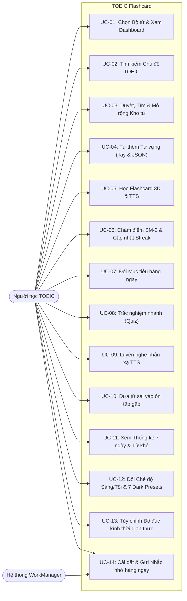

| Mã UC | Tên Use Case | Tác nhân | Luồng xử lý chính | Điều kiện biên / Hậu điều kiện |
| --- | --- | --- | --- | --- |
| **UC-01** | Chọn Bộ từ & Xem Dashboard | Người học | Mở `DeckSwitcherSheet` từ Dropdown -> Gọi `setSelectedDeckId(deckId)` -> `ObserveHomeSummaryUseCase` & `VocabularyVaultViewModel` tự lọc tức thì. | Bộ từ rỗng (`custom_user` 0 từ) vẫn tắt loading và hiện thẻ hướng dẫn, không treo spinner. |
| **UC-02** | Tìm kiếm Chủ đề TOEIC | Người học | Nhập từ khóa vào `LiquidGlassSearchCapsule` -> lọc không phân biệt hoa thường trên cả tên tiếng Anh và phụ đề tiếng Việt. | Nếu không khớp chủ đề nào, hiển thị thẻ thông báo rỗng thân thiện. |
| **UC-03** | Duyệt & Lọc Kho từ vựng | Người học | Chọn bộ từ qua `VaultDeckDropdownPill`, lọc 1 hàng chip (`Tất cả`, `Hay quên`, `Đang học`, `Đã thuộc`), tìm kiếm, chạm thẻ xem ví dụ & phát âm. | Tác động tìm kiếm/lọc chạy trên `Dispatchers.Default`, số lượng từng chip cập nhật động theo bộ từ. |
| **UC-04** | Tự thêm Từ vựng (Tay / JSON) | Người học | Mở `AddVocabularySheet` từ nút `+` trên Kho từ -> Nhập form hoặc chọn tệp `.json` -> `AddCustomVocabularyUseCase` chuẩn hóa & lưu DB. | Tự bóc BOM, kiểm tra trùng lặp không phân biệt hoa thường với toàn DB, cấp ID `>= 3001`, gán `deckId = "custom_user"`. |
| **UC-05** | Học Flashcard 3D & Phát âm TTS | Người học | Chọn **Ôn tập ngay** (tối đa 20 từ đến hạn) hoặc 1 chủ đề -> Chạm thẻ lật 3D -> Nghe từ / nghe ví dụ -> Đổi tốc độ `0.75x`/`1.0x`. | Hết từ đến hạn trong chủ đề tự chuyển sang **Ôn luyện tự do**; báo Snackbar nếu thiếu gói giọng US TTS. |
| **UC-06** | Chấm điểm SM-2 & Cập nhật Streak | Người học | Chọn `Quên / Khó / Bình thường / Dễ` -> `SubmitReviewUseCase` tính `Sm2Scheduler`, lưu Room và cập nhật `StreakCalculator` + lịch sử ngày vào DataStore. | Chọn `Quên` (`q = 1`) đẩy thẻ về cuối hàng đợi phiên học cho đến khi nhớ lại. |
| **UC-07** | Đổi Mục tiêu ngày | Người học | Chạm vòng tròn tiến độ trên `HeroGlassDashboard` -> Chọn `5`, `10` hoặc `20` từ -> Lưu `daily_goal` vào DataStore. | Vòng tiến độ và đường kẻ mục tiêu trên biểu đồ `StatsScreen` cập nhật ngay. |
| **UC-08** | Trắc nghiệm nhanh (Quiz) | Người học | Từ tab `Luyện tập`, chọn **Trắc nghiệm nhanh** -> Chọn toàn bộ bộ từ đang học hoặc 1 chủ đề trong `QuizScopeDialog` -> Chọn đáp án. | Khóa lựa chọn ngay sau lần chạm đầu tiên, tự chuyển câu sau `1.2s`. |
| **UC-09** | Luyện nghe phản xạ TTS | Người học | Chọn **Luyện nghe từ vựng** -> Ẩn mặt chữ tiếng Anh & IPA, tự động đọc từ qua TTS -> Mở đáp án sau khi trả lời. | Có nút chỉnh nhanh tốc độ `1.0x`/`0.75x` ngay trên TopBar của `QuizScreen`. |
| **UC-10** | Đưa từ sai vào ôn tập gấp | Người học | Tại màn hình tổng kết Quiz/Listening, nhấn **"Đưa các từ sai vào diện ôn tập gấp"** -> `MarkWordsUrgentReviewUseCase`. | Cập nhật `nextReviewTimestamp = nowMillis` cho các từ làm sai. |
| **UC-11** | Xem Thống kê & Ôn từ khó | Người học | Mở tab `Thống kê` -> Xem biểu đồ 7 ngày, tiến độ 4 bộ từ, 8 nhóm chủ đề, Top 8 từ khó (`EF` thấp) -> Bấm **"Ôn lại nhóm từ khó"**. | Ôn nhóm từ khó quét toàn kho từ vựng (`deckId = null`) để đảm bảo đủ mọi từ khó hiển thị. |
| **UC-12** | Đổi Sáng/Tối & 7 Dark Presets | Người học | Bấm nút Mặt trăng/Mặt trời trên `HomeScreen` hoặc mở Sheet Cài đặt chọn `SYSTEM`/`LIGHT`/`DARK` và 1 trong 7 bảng màu Dark Tone. | Chọn một Dark Preset khi đang Light Mode tự động kích hoạt Dark Mode atomically. |
| **UC-13** | Tùy chỉnh Độ đục kính | Người học | Kéo Slider `45%..95%` trong `ReminderSettingsSheet` -> Cập nhật `LocalGlassOpacity` tức thì; bấm **"Mặc định"** để xóa khóa. | Phục hồi đúng `82%` cho Dark Mode và `75%` cho Light Mode. |
| **UC-14** | Nhắc nhở hàng ngày | Người học & WorkManager | Bật công tắc nhắc nhở (xin quyền `POST_NOTIFICATIONS` trên API 33+), chọn giờ -> `DailyReminderWorker` chạy định kỳ mỗi 24h. | Không làm phiền nếu người học đã hoàn thành hết từ đến hạn và đạt mục tiêu ngày. |

---

## 6. Biểu Đồ Tuần Tự (Sequence Diagrams)

### SD-1: Nâng cấp Room v2 → v3 (`MIGRATION_2_3`) & Nạp Idempotent 4 JSON Assets (2.154 từ)

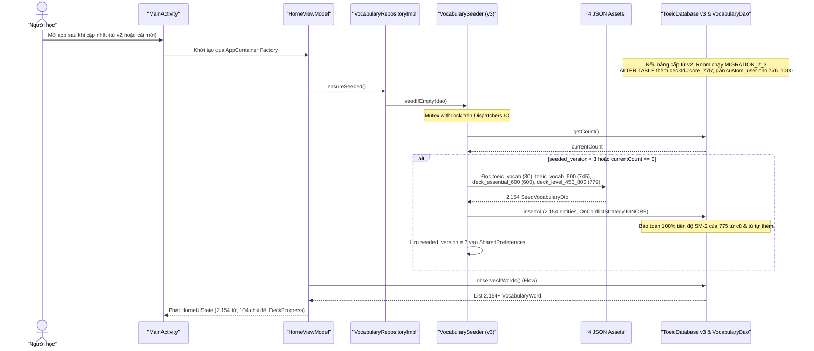

### SD-2: Học Flashcard 3D, TTS & Chấm Điểm SM-2 + Cập Nhật Streak/Lịch Sử 7 Ngày

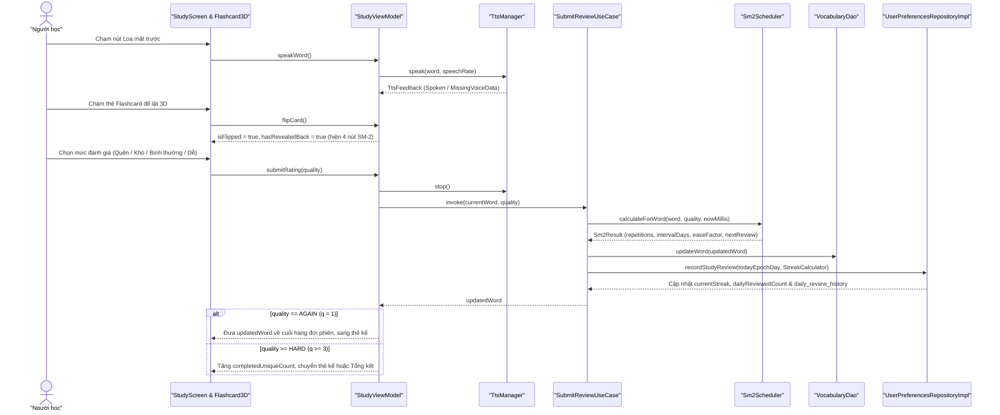

### SD-3: Trắc Nghiệm / Luyện Nghe TTS (`QuizScreen`) & Đưa Từ Sai Vào Ôn Gấp

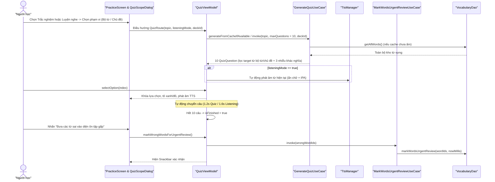

### SD-4: Tự Thêm Từ Vựng Mới (Nhập Tay & Import JSON)

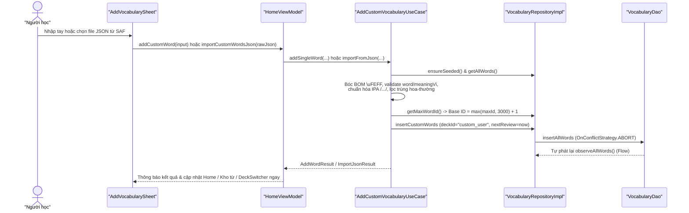

### SD-5: Đồng Bộ Bộ Từ, Chuyển 7 Dark Presets, Slider Kính & Nhắc Nhở Hàng Ngày

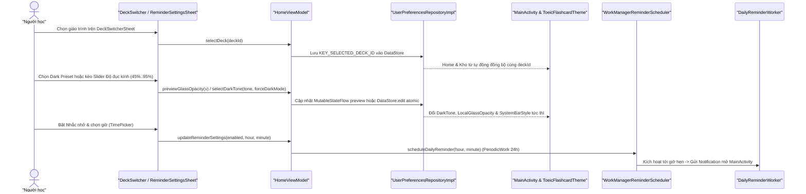

---

## 7. Thiết Kế Cơ Sở Dữ Liệu & Máy Trạng Thái

### Lược đồ lưu trữ (`Room SQLite v3` & `DataStore Preferences`)

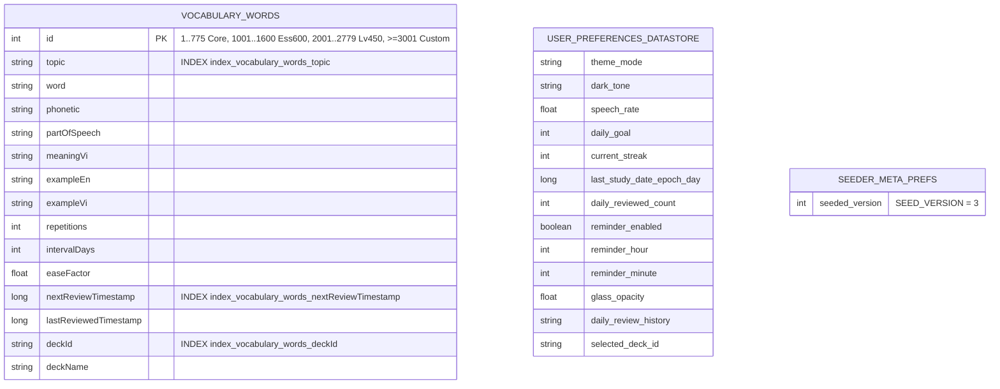

- **Chiến lược Migration an toàn (`ToeicDatabase.kt`):**
  - `MIGRATION_1_2`: Bổ sung 2 index tăng tốc truy vấn theo `topic` và `nextReviewTimestamp`.
  - `MIGRATION_2_3`: `ALTER TABLE` thêm 2 cột `deckId` (mặc định `'core_775'`) và `deckName` (mặc định `'TOEIC Cốt Lõi (775)'`), cập nhật các từ tự thêm cũ (`776..1000`) sang `'custom_user'`, tạo index `index_vocabulary_words_deckId` và giữ nguyên **100%** lịch ôn SM-2 hiện có.

### Máy trạng thái SM-2 & Daily Streak

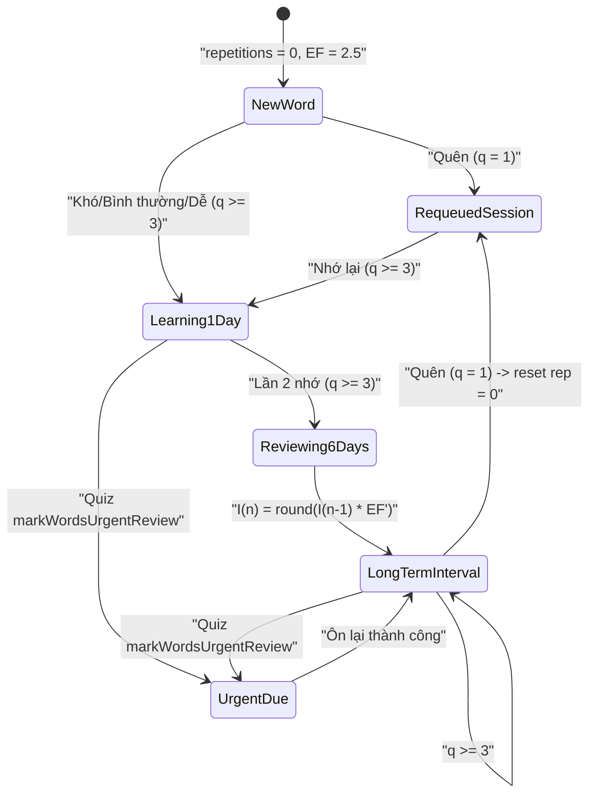

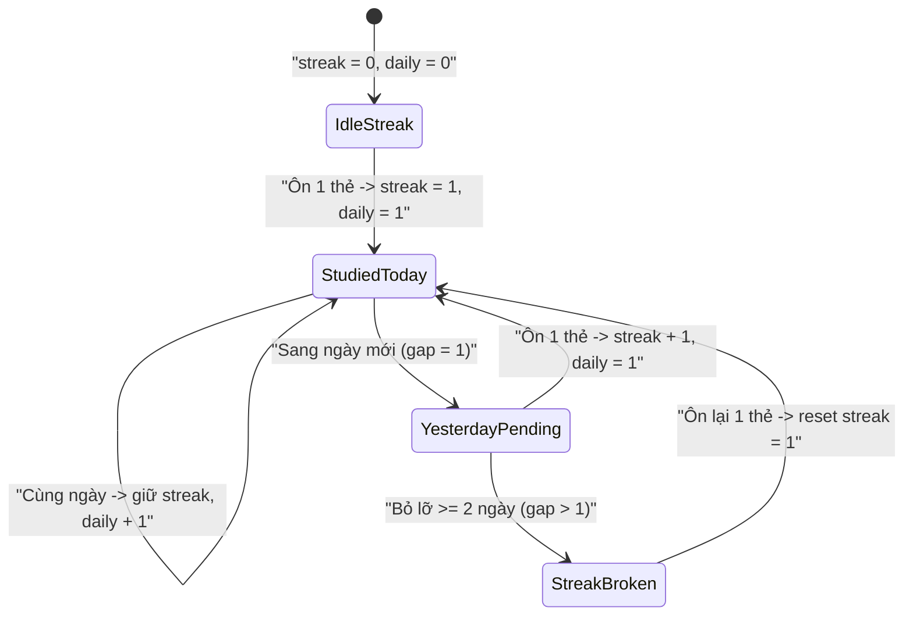

---

## 8. Kết Quả Kiểm Thử, Kiểm Chứng 120Hz & Ảnh Chụp Thực Tế

### Kết quả kiểm thử đơn vị (`.\gradlew.bat testDebugUnitTest`)

| Bộ kiểm thử | Số test case | Trạng thái | Nội dung kiểm chứng |
| --- | :---: | :---: | --- |
| `Sm2SchedulerTest` | 10 | **10/10 Pass** | Công thức `EF'` không dưới `1.3f`, khoảng lặp `1 -> 6 -> round(I*EF')`, reset khi `q < 3`, nhãn tiếng Việt |
| `StreakCalculatorTest` | 6 | **6/6 Pass** | Ngày đầu, tăng chuỗi qua ngày hôm sau, cộng dồn cùng ngày, đứt chuỗi quá 1 ngày, hiển thị an toàn |
| `GenerateQuizUseCaseTest` | 5 | **5/5 Pass** | Sinh 10 câu toàn khóa / theo chủ đề / theo `deckId`, lọc đáp án nhiễu không trùng nghĩa, đường dẫn cache ấm/lạnh |
| `DarkTonePreferencesTest` | 4 | **4/4 Pass** | 7 `DarkTone` presets, cập nhật atomic `forceDarkMode`, map fallback legacy ID và `selected_deck_id` DataStore |
| `SeedVocabularyParsingTest` | 3 | **3/3 Pass** | Parse hợp lệ cả **4 file JSON assets = 2.154 từ / 104 chủ đề**, 0 trùng ID, 100% chủ đề khớp `TopicVisuals` |
| `AddCustomVocabularyUseCaseTest` | 3 | **3/3 Pass** | Cấp ID `>= 3001`, gán `custom_user`, bóc BOM JSON, lọc trùng hoa-thường, xử lý lỗi JSON tiếng Việt |
| `GetStudyQueueUseCaseTest` | 3 | **3/3 Pass** | Hàng đợi ôn hạn, từ khó, tự do theo chủ đề & lọc theo `deckId` trên cả cache lẫn suspend Room |
| `GlassOpacityPreferencesTest` | 2 | **2/2 Pass** | Giá trị mặc định `0.82f` Dark / `0.75f` Light, clamp chặt biên `0.45f..0.95f` |
| `DisplayRefreshRateSelectionTest` | 2 | **2/2 Pass** | `selectHighestRefreshRateModeId` chọn đúng `120Hz` khớp độ phân giải màn hình hiện tại (`1080x2436`) |
| **Tổng cộng (`9` suites)** | **38** | **38/38 Pass** | **0 failures, 0 errors, 0 skipped** |

### Kiểm chứng thực tế trên thiết bị (`TECNO CLA5` — Android 16)
- **Nâng cấp DB v2 → v3 không mất dữ liệu:** Cài đè `.\gradlew.bat installDebug` giữ nguyên tiến độ SM-2 cũ (`31` từ đã thuộc, chuỗi `2 ngày`) khi ngân hàng từ vựng mở rộng từ `775` lên **2.154 từ**; `logcat -d -s AndroidRuntime:E SQLiteLog:E Room:E` xác nhận **0 lỗi**.
- **Xác nhận 120Hz Adaptive Refresh Rate qua ADB:**
  - `adb shell dumpsys display`: `mActiveModeId=1`, `mActiveRenderFrameRate=120.00001`, `BaseModeRefreshRateVote{ mAppRequestBaseModeRefreshRate=120.00001 }`.
  - `adb shell dumpsys SurfaceFlinger --latency`: chu kỳ đồng bộ `8333333` ns (`8.33ms` = **120Hz**). Trên bộ đếm FPS thiết bị, ứng dụng hiển thị `120` khi cuộn/tương tác và tự hạ về `60` khi đứng yên để tiết kiệm pin.
- **Đóng gói Benchmark APK:** `.\gradlew.bat assembleBenchmark` biên dịch thành công (`isDebuggable = false`).

### Thư viện màn hình thực tế Light & Dark (`screenshots_liquid_glass/`)

| Trang chủ (Light) | Trang chủ (Dark) | Trang chủ cuộn + Floating Search (Light) | Trang chủ cuộn + Floating Search (Dark) |
| :---: | :---: | :---: | :---: |
| 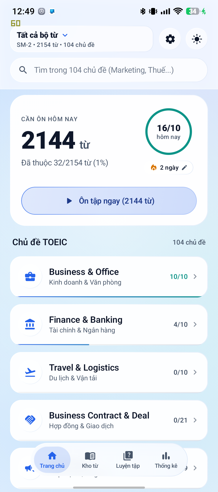 | 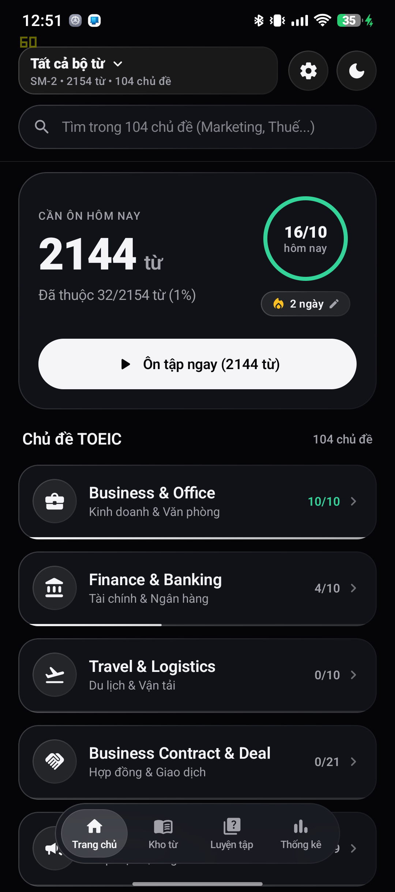 | 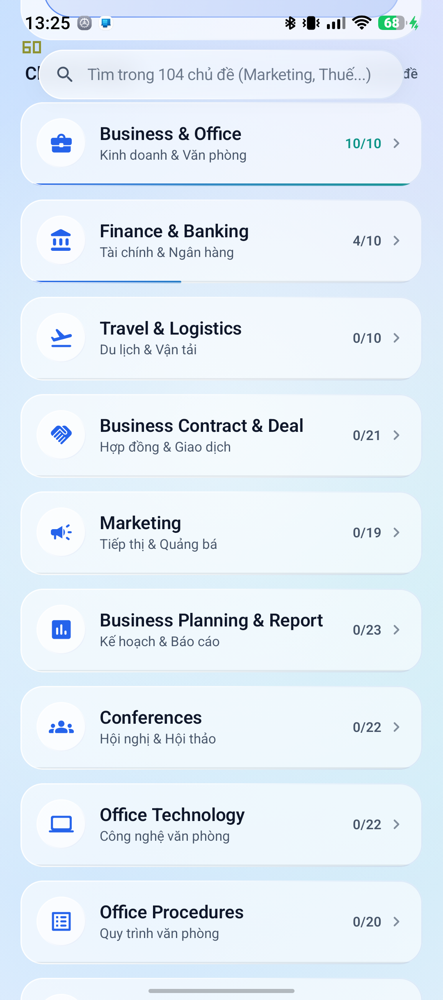 | 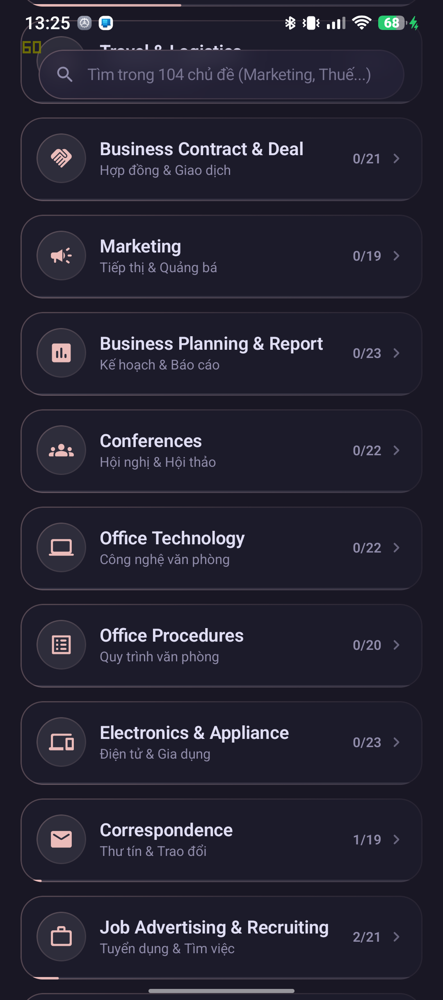 |

| Deck Switcher Sheet | Flashcard 3D Mặt trước | Flashcard Mặt sau & SM-2 (Light) | Flashcard Mặt sau & SM-2 (Dark) |
| :---: | :---: | :---: | :---: |
| 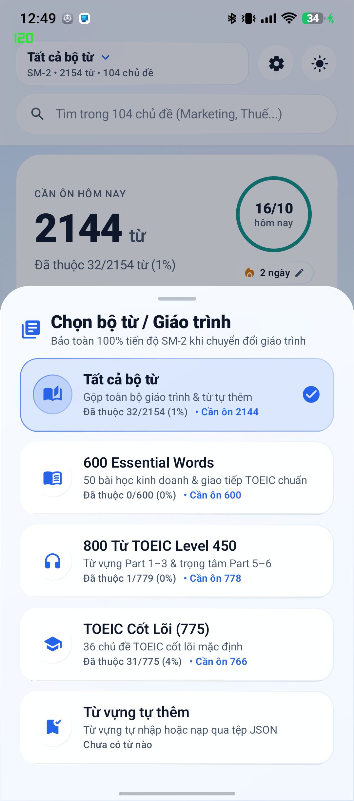 | 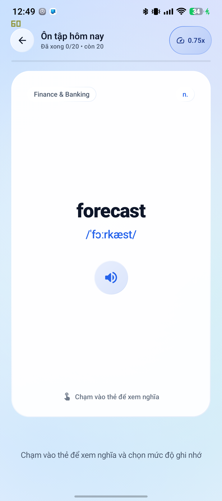 | 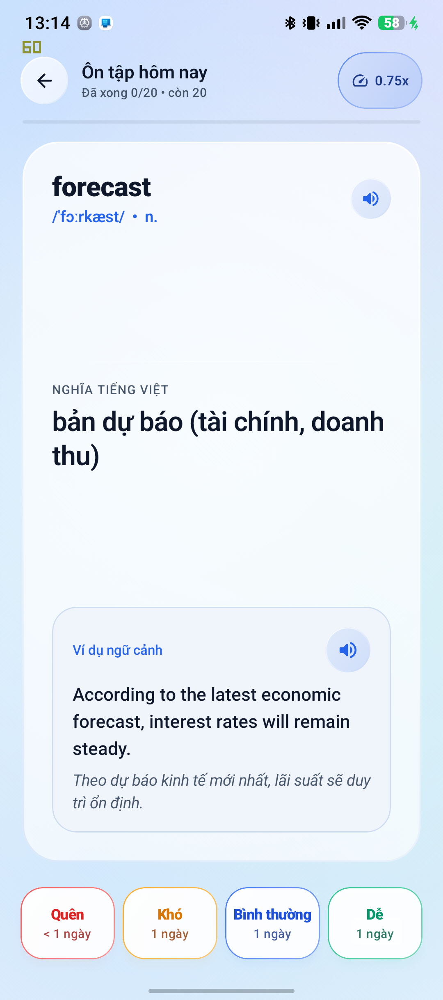 | 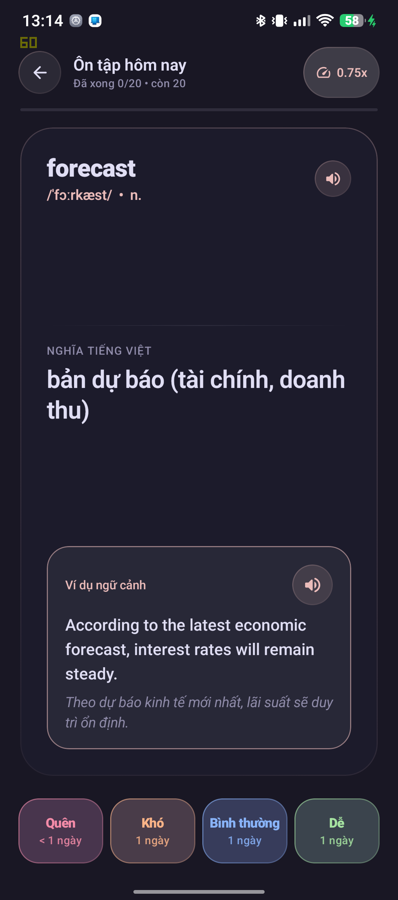 |

| Tab Luyện tập (Light) | Trắc nghiệm nhanh (Light) | Tab Kho từ (Light) | Thêm từ mới (Light) |
| :---: | :---: | :---: | :---: |
| 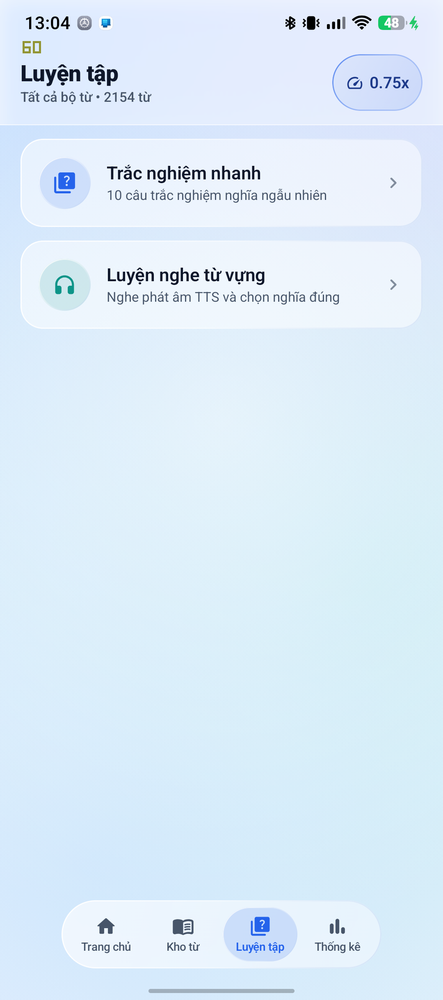 | 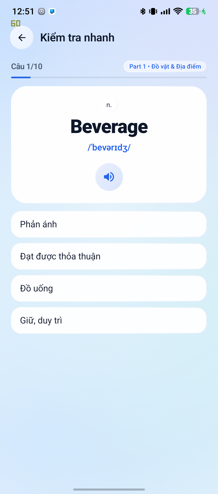 | 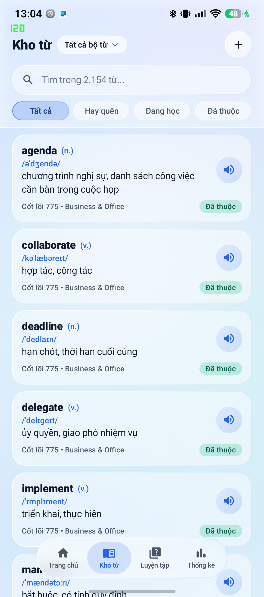 | 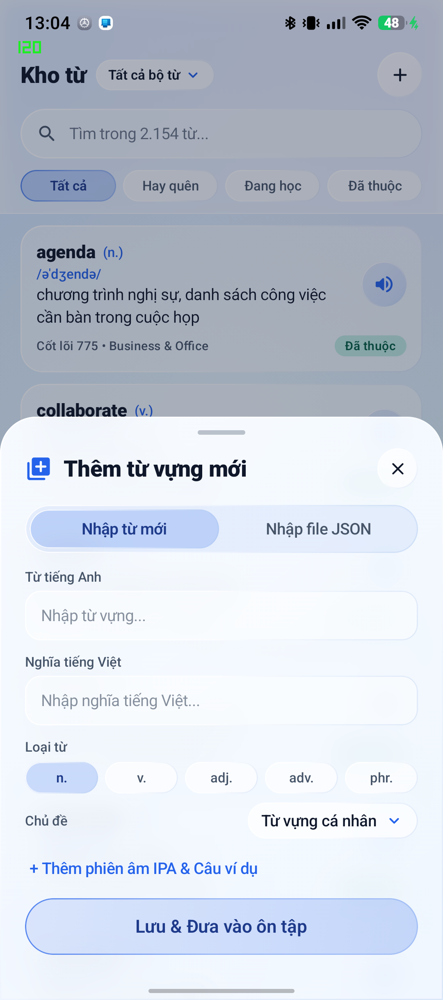 |

| Thống kê học tập (Dark) | Cài đặt & Độ đục kính (Light) | Cài đặt & Dark Presets (Dark) | |
| :---: | :---: | :---: | :---: |
| 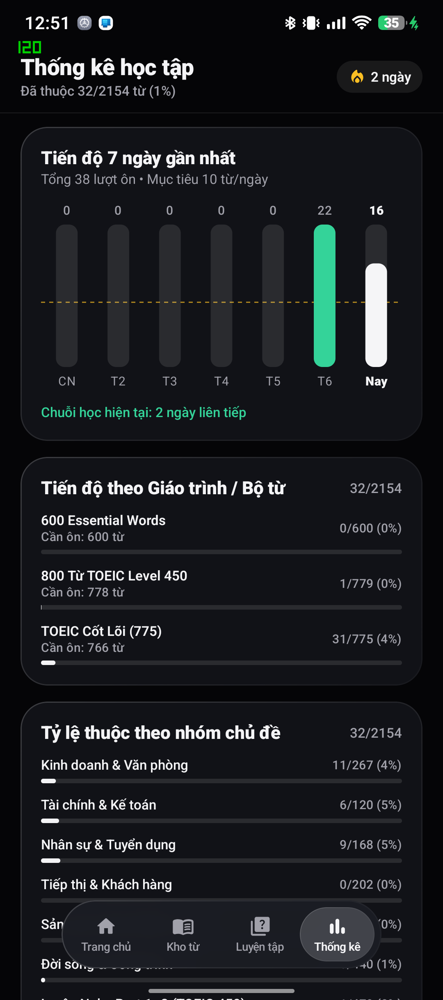 | 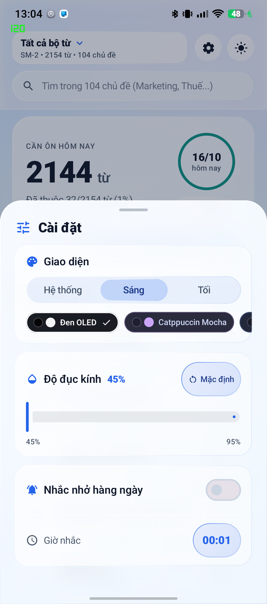 | 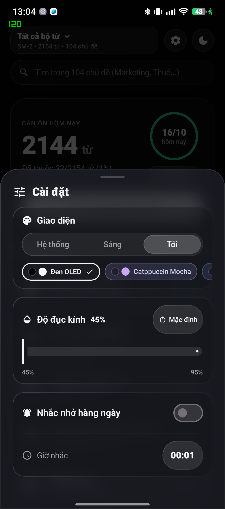 | |

---

## 9. Hướng Dẫn Build, Kiểm Thử & Định Dạng JSON Import

### Lệnh Gradle & ADB thường dùng (PowerShell)
```powershell
# Chạy toàn bộ 38 unit tests và đóng gói bản Benchmark release-like
.\gradlew.bat testDebugUnitTest assembleBenchmark

# Cài đặt trực tiếp lên thiết bị Android qua ADB
.\gradlew.bat installDebug

# Kiểm tra tần số quét màn hình và nhật ký lỗi runtime
adb shell dumpsys display | Select-String -Pattern "mActiveModeId|mActiveRenderFrameRate"
adb shell dumpsys SurfaceFlinger --latency | Select-Object -First 3
adb logcat -d -s AndroidRuntime:E SQLiteLog:E Room:E
```

### Cấu trúc file `.json` hỗ trợ tính năng Tự thêm từ (`AddVocabularySheet`)
```json
[
  {
    "word": "synergy",
    "phonetic": "/ˈsɪnərdʒi/",
    "partOfSpeech": "n.",
    "meaningVi": "hợp lực, sức mạnh cộng hưởng",
    "topic": "Chiến lược",
    "exampleEn": "The merger created strong operational synergy.",
    "exampleVi": "Thương vụ sáp nhập đã tạo ra sức mạnh cộng hưởng vận hành lớn."
  }
]
```
> *Lưu ý:* Trường `word` và `meaningVi` là bắt buộc; các trường còn lại (`phonetic`, `partOfSpeech`, `topic`, `exampleEn`, `exampleVi`) có thể để trống hoặc tùy chọn và sẽ được tự động chuẩn hóa khi lưu vào `custom_user`.
