<div align="center">

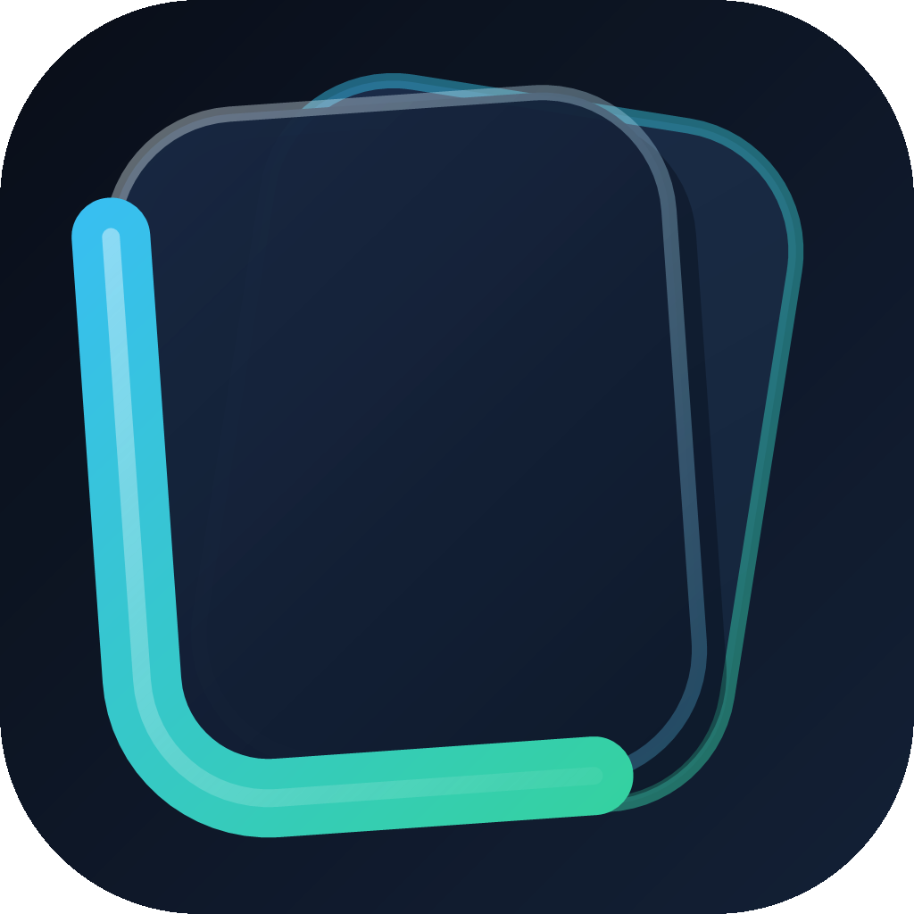

# Lexora — TOEIC Vocabulary • SM-2

**Ứng dụng học từ vựng TOEIC 100% offline, không quảng cáo — thiết kế Kính mờ tối giản (Frosted Glass), thuật toán lặp lại ngắt quãng SM-2 và tự thích ứng đa màn hình (Phone • Galaxy Z Fold • Tablet).**

[](https://kotlinlang.org/)
[](https://developer.android.com/compose)
[](https://developer.android.com/)
[-0F9D58?style=flat-square)](https://developer.android.com/training/data-storage/room)
[](#-tính-năng-cốt-lõi)
[-0D9488?style=flat-square)](#-kiến-trúc-kỹ-thuật-dành-cho-developer)
[](https://github.com/NgocTanHoang/Toeic_Flashcard_Android/releases/latest)

<br />

[📥 Tải bản thử nghiệm (APK)](#-tải-bản-thử-nghiệm-android-beta-apk) •
[📱 Giao diện thực tế](#-trưng-bày-giao-diện-thực-tế) •
[✨ Tính năng cốt lõi](#-tính-năng-cốt-lõi) •
[🐛 Góp ý & Báo lỗi](#-góp-ý--báo-lỗi-beta-feedback) •
[🛠️ Kiến trúc kỹ thuật](#-kiến-trúc-kỹ-thuật-dành-cho-developer)

</div>

---

## 📥 Tải bản thử nghiệm Android (Beta APK)

> **Miễn phí • 100% Offline • Không quảng cáo • Dung lượng nhẹ ~2.1 MB**

👉 **[Tải file APK mới nhất tại GitHub Releases](https://github.com/NgocTanHoang/Toeic_Flashcard_Android/releases/latest)**

### Hướng dẫn cài đặt nhanh (3 bước)
1. **Tải file `.apk`:** Mở liên kết Releases ở trên và tải tệp `.apk` mới nhất về điện thoại hoặc máy tính bảng Android (Android 7.0 trở lên).
2. **Cho phép cài đặt ứng dụng:** Nhấn vào tệp vừa tải; nếu Android hỏi quyền cài đặt từ trình duyệt/trình quản lý tệp, chọn **Cài đặt (Settings) → Bật "Cho phép từ nguồn này"**.
3. **Mở Lexora & Bắt đầu học:** Chọn bộ từ vựng phù hợp mục tiêu TOEIC của bạn (`600 Từ TOEIC Cốt Lõi`, `775 Từ TOEIC Mở Rộng` hoặc `800 Từ TOEIC Nâng Cao`).
   - *Lưu ý nâng cấp:* Các bản cập nhật cài đè trực tiếp sẽ **giữ nguyên 100% lịch sử học SM-2 và từ tự thêm**.

---

## 📱 Trưng bày giao diện thực tế

> Toàn bộ ảnh bên dưới được chụp trực tiếp từ ứng dụng chạy trên thiết bị thực (**TECNO CLA5**, **Galaxy Z Fold** & **Redmi Pad 2 16:10**).

### 1. Trang chủ Learning Dashboard, Flashcard 3D SM-2 & Màn hình Chủ đề
<table>
  <tr>
    <td align="center">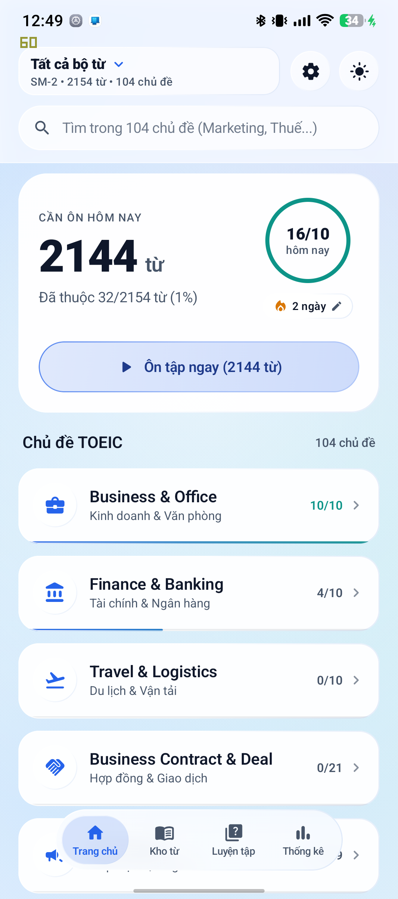</td>
    <td align="center">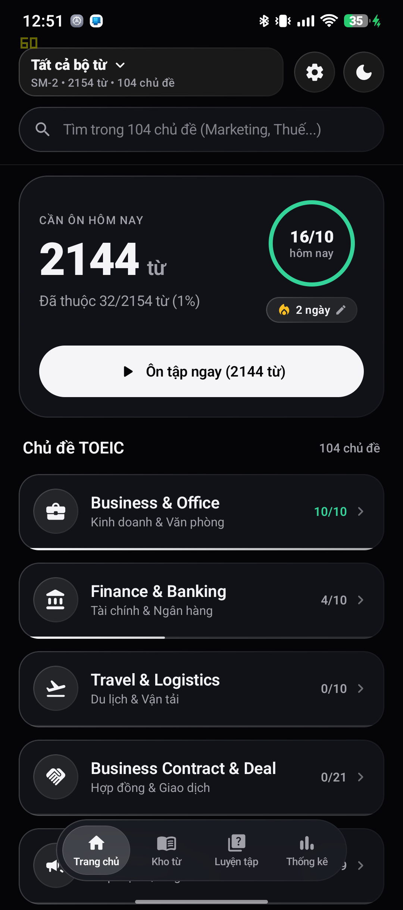</td>
    <td align="center">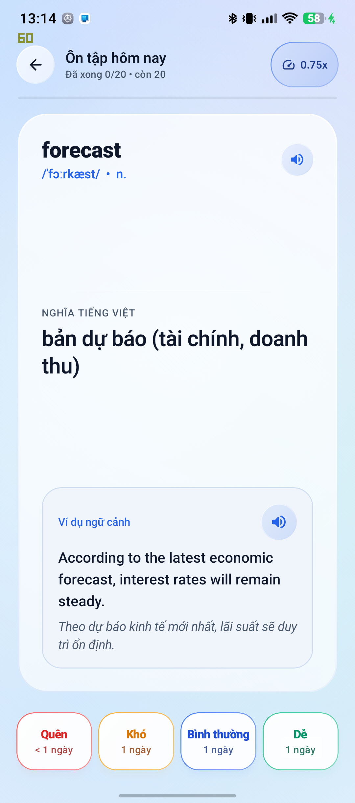</td>
    <td align="center"></td>
    <td align="center">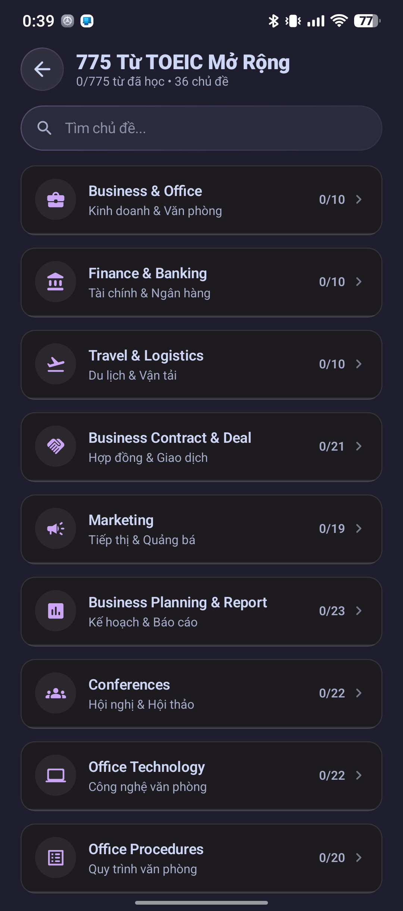</td>
  </tr>
  <tr>
    <td align="center"><sub><b>Trang chủ • Light</b></sub></td>
    <td align="center"><sub><b>Trang chủ • OLED Dark</b></sub></td>
    <td align="center"><sub><b>Flashcard SM-2 • Light</b></sub></td>
    <td align="center"><sub><b>Flashcard SM-2 • Dark</b></sub></td>
    <td align="center"><sub><b>Danh sách Chủ đề</b></sub></td>
  </tr>
</table>

### 2. Kho từ vựng cá nhân & Thống kê tiến độ
<table>
  <tr>
    <td align="center"></td>
    <td align="center"></td>
    <td align="center">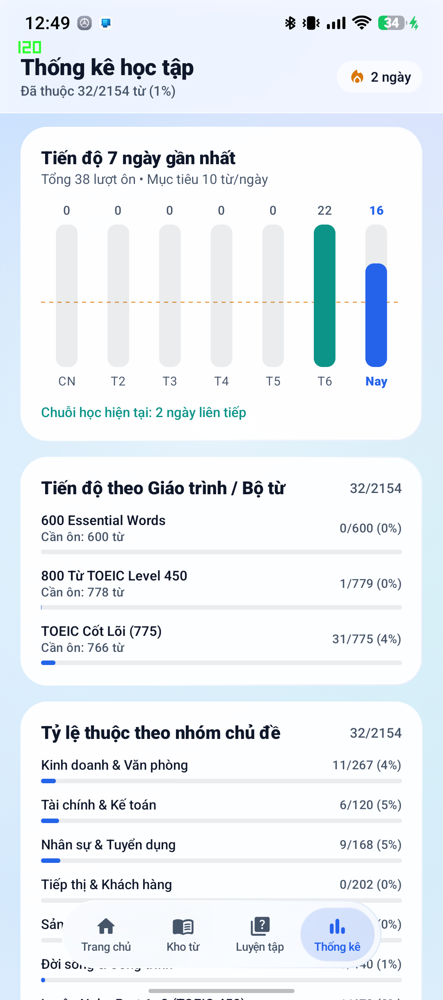</td>
    <td align="center">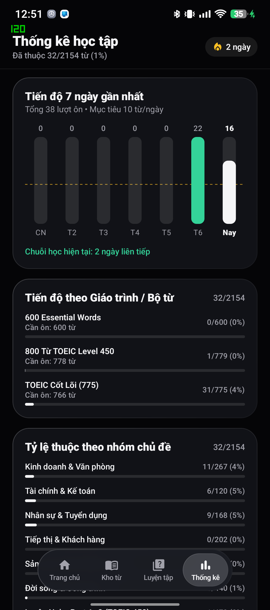</td>
  </tr>
  <tr>
    <td align="center"><sub><b>Kho từ • Light</b></sub></td>
    <td align="center"><sub><b>Kho từ • Dark</b></sub></td>
    <td align="center"><sub><b>Thống kê • Light</b></sub></td>
    <td align="center"><sub><b>Thống kê • Dark</b></sub></td>
  </tr>
</table>

### 3. Tự thích ứng Galaxy Z Fold & Tablet ngang (Redmi Pad 2 16:10)
<table>
  <tr>
    <td align="center">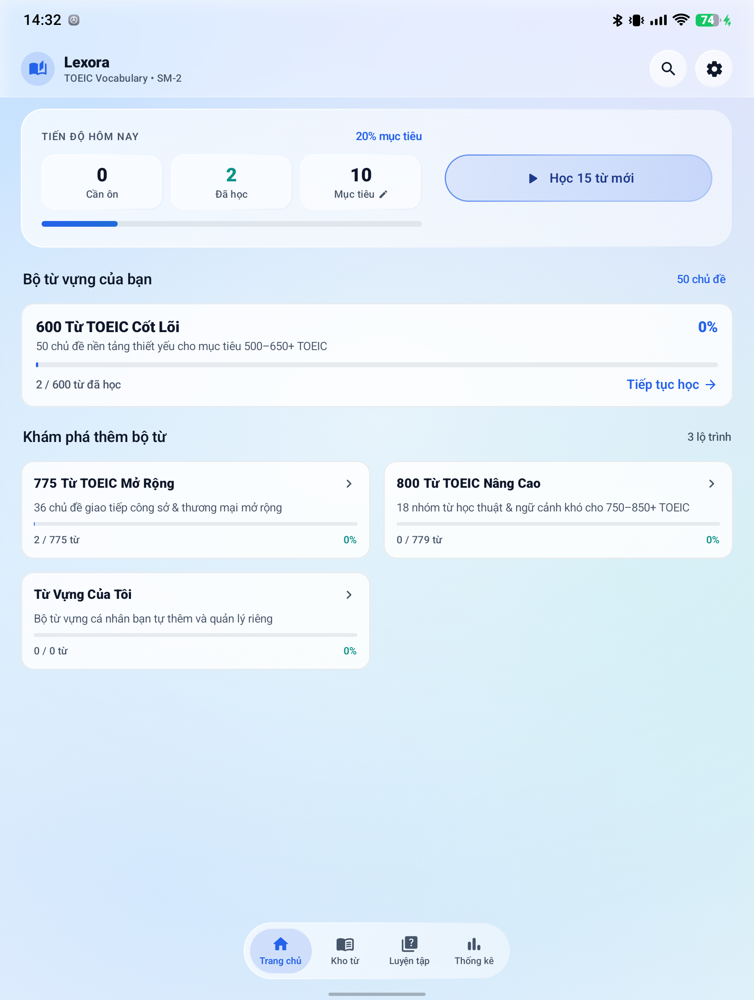</td>
    <td align="center">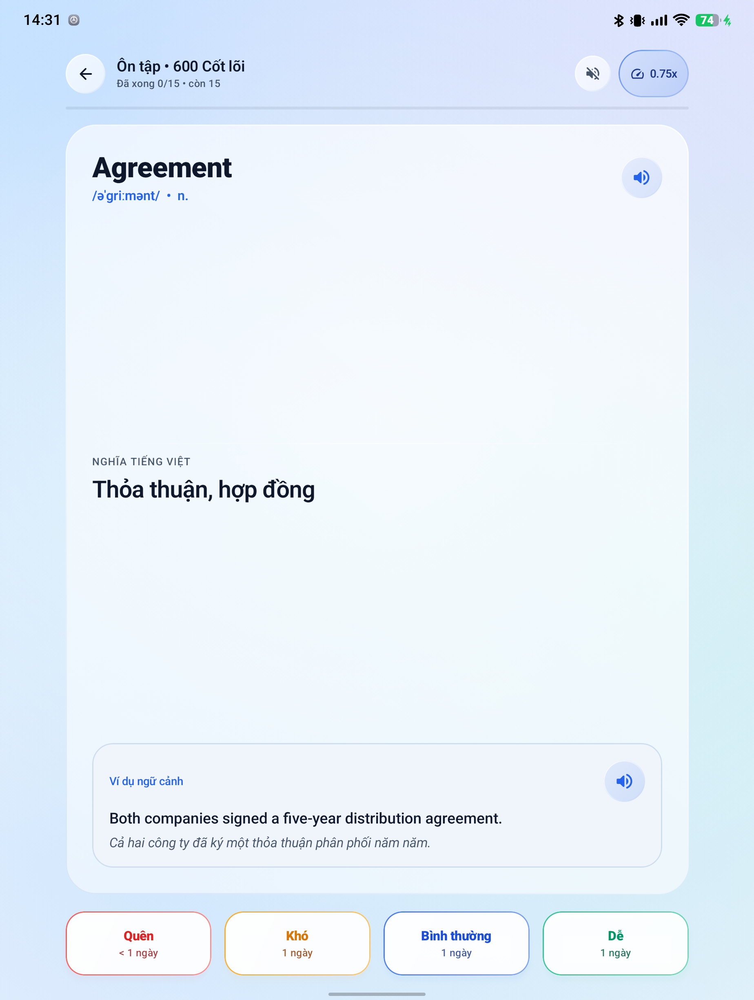</td>
    <td align="center">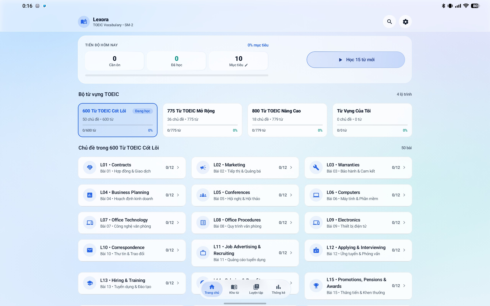</td>
    <td align="center">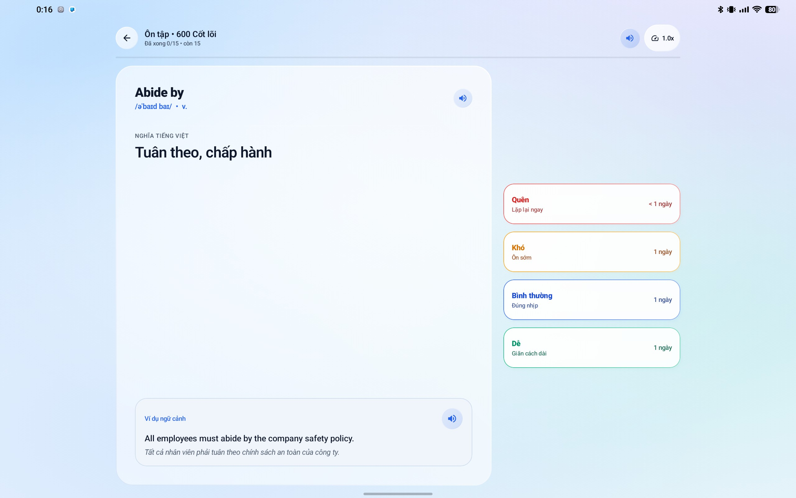</td>
  </tr>
  <tr>
    <td align="center"><sub><b>Z Fold Inner • Home 2 cột</b></sub></td>
    <td align="center"><sub><b>Z Fold Inner • Flashcard</b></sub></td>
    <td align="center"><sub><b>Tablet ngang • 4 bộ từ + 3 cột</b></sub></td>
    <td align="center"><sub><b>Tablet ngang • 2-pane SM-2</b></sub></td>
  </tr>
</table>

### 4. Video giới thiệu (30s • 60fps) & App Icon v3
<table>
  <tr>
    <td align="center" width="40%">
      <a href="media/toeic_flashcard_promo_30s.mp4">
        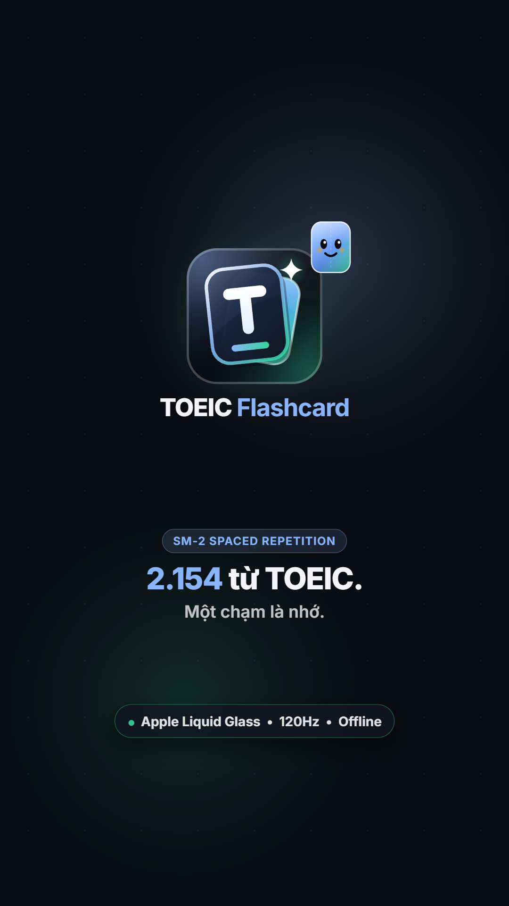
      </a>
      <br />
      <sub><a href="media/toeic_flashcard_promo_30s.mp4"><b>▶ Xem / Tải Video Showreel 60fps (30s)</b></a></sub>
    </td>
    <td align="center" width="60%">
      
      <br />
      <sub>Adaptive Icon v3 "Lexora Glass Monogram" (70% Safe Zone, hỗ trợ Squircle / Circle / Monochrome API 33+)</sub>
    </td>
  </tr>
</table>

---

## ✨ Tính năng cốt lõi

- **2.154+ từ vựng TOEIC / 104 chủ đề (100% Offline):** Chia thành 3 bộ giáo trình chuẩn hóa (*600 Từ TOEIC Cốt Lõi*, *775 Từ TOEIC Mở Rộng*, *800 Từ TOEIC Nâng Cao*) và kho *Từ Vựng Của Tôi* (hỗ trợ thêm tay & nhập/xuất hàng loạt qua `.json`).
- **Thuật toán lặp lại ngắt quãng SuperMemo-2 (SM-2):** Tách bạch `Đến hạn ôn` và `Từ mới`, tính khoảng lặp tối ưu qua 4 mức đánh giá (`Quên`, `Khó`, `Bình thường`, `Dễ`), hỗ trợ **Hoàn tác (Undo)** lượt vừa chấm và thẻ tổng kết phiên học (`SessionSummaryCard`).
- **Thẻ Flashcard 3D & Phát âm TTS ngoại tuyến:** Hiệu ứng lật 3D mượt mà (`graphicsLayer`), hỗ trợ tốc độ đọc `0.75x / 1.0x`, tự động phát âm và câu ví dụ ngữ cảnh.
- **Luyện tập Quiz & Nghe phản xạ:** Trắc nghiệm 10 câu và chế độ Luyện nghe ẩn mặt chữ, tự động đưa các từ làm sai vào hàng đợi ôn tập gấp.
- **Hệ sinh thái Kính mờ tối giản (Minimalist Glassmorphism & Flat Surface):** Kính mờ thời gian thực (`Haze`), thanh tìm kiếm thả nổi khi cuộn (`CollapsibleHeaderState`), **7 bảng màu Dark Mode** (*Đen OLED*, *Catppuccin Mocha*, *Tokyo Night*, *Nord*, *Rosé Pine*, *Gruvbox*, *GitHub Dark*) và thanh trượt **Độ đục kính (`45% – 95%`)**.

---

## 🐛 Góp ý & Báo lỗi (Beta Feedback)

Mọi góp ý về giao diện, từ vựng hoặc lỗi hiển thị trên thiết bị của bạn đều rất quý giá!

1. Mở trang **[GitHub Issues](https://github.com/NgocTanHoang/Toeic_Flashcard_Android/issues/new)** để gửi báo lỗi hoặc đề xuất tính năng.
2. Khi báo lỗi, vui lòng đính kèm ngắn gọn: **Tên máy** (ví dụ: Galaxy Z Fold 6, Redmi Pad 2, Pixel 8...), **Phiên bản Android**, **Các bước gặp lỗi** và **Ảnh chụp màn hình** (nếu có).
3. **Sao lưu tiến độ trước khi nâng cấp:** Trong mục **Cài đặt** (biểu tượng bánh răng ở Trang chủ), bạn có thể sử dụng tính năng **Xuất dữ liệu JSON** để lưu trữ toàn bộ từ vựng cá nhân và tiến độ học tập phòng trường hợp gỡ cài đặt ứng dụng.

---

## 🛠️ Kiến trúc kỹ thuật (Dành cho Developer)

### Tech Stack & Kiến trúc
- **Ngôn ngữ & UI:** Kotlin `2.0.21`, Jetpack Compose (BOM `2024.12.01`), Material 3, Navigation Compose Type-Safe (`@Serializable`).
- **Kiến trúc:** Clean Architecture 3 tầng (`domain` Pure Kotlin / `data` / `presentation`) + MVVM + Manual DI (`AppContainer`).
- **Lưu trữ ngoại tuyến:** Room SQLite `2.6.1` (Schema `v4` với `isStarred` migration + `Mutex` Seeder) & Jetpack DataStore Preferences (`13` khóa + real-time glass opacity preview).
- **Đồ họa & Hiệu năng:** `dev.chrisbanes.haze:haze:1.0.0` (Single `HazeSource`), 120Hz Adaptive Refresh Rate (`Display.Mode` + API 35 `frameRateBoostOnTouchEnabled`), tối ưu `R8` + `shrinkResources` (~`2.1 MB` APK).
- **Adaptive Layout 2 trục (`AppWindowMetrics` + `AdaptiveLayout`):** Hỗ trợ Smartphone chuẩn, 3 nhóm màn hình Galaxy Z Fold (`isNarrowCover < 385.dp`, `isShortCover 10:16`, `isFoldInnerExpanded 600–899.dp`), và Tablet Landscape (`>= 900.dp`).
- **Kiểm thử tự động:** **19 bộ Unit Test JVM** bao phủ SM-2, Streak, Vault Sync, TTS/Reminder, Onboarding và ma trận Responsive đa thiết bị.

### Build & Chạy Unit Test cục bộ
```powershell
git clone https://github.com/NgocTanHoang/Toeic_Flashcard_Android.git
cd Toeic_Flashcard_Android

# Chạy toàn bộ Unit Test JVM và đóng gói APK Release (R8)
.\gradlew.bat testDebugUnitTest assembleRelease
```

### Tài liệu chuyên sâu
- **[`docs/TECHNICAL_DOCUMENTATION.md`](./docs/TECHNICAL_DOCUMENTATION.md)** — Đặc tả kiến trúc, công thức SM-2, ma trận Adaptive UI & Room v4.
- **[`docs/UI_AUDIT_BLUEPRINT.md`](./docs/UI_AUDIT_BLUEPRINT.md)** — Sơ đồ luồng người dùng Mermaid & Wireframe kiểm toán UX.
- **[`PROJECT_REPORT.md`](./PROJECT_REPORT.md)** — Báo cáo tổng hợp 14 Use Cases, Sequence Diagrams & Kết quả kiểm thử.
