<div align="center">

# Lexora — TOEIC Vocabulary • SM-2

**Ứng dụng học từ vựng TOEIC đa giác quan & ngoại tuyến 100% trên Android (Phone, Foldable & Tablet) — thiết kế Apple Liquid Glass, thuật toán lặp lại ngắt quãng SM-2 và hiệu năng 120Hz Adaptive Refresh Rate.**

[](https://kotlinlang.org/)
[](https://developer.android.com/compose)
[](https://developer.android.com/)
[-0F9D58?style=flat-square)](https://developer.android.com/training/data-storage/room)
[](#-kho-d%E1%BB%AF-li%E1%BB%87u-2154-t%E1%BB%AB-v%E1%BB%B1ng)
[](#-hi%E1%BB%87u-n%C4%83ng-120hz-arr--h%C3%A0nh-vi-cu%E1%BB%99n-ios)
[](https://github.com/NgocTanHoang/Toeic_Flashcard_Android/releases/latest)

<br />

[Tải APK v1.4.0](https://github.com/NgocTanHoang/Toeic_Flashcard_Android/releases/latest) •
[Video 30s & App Icon v3](#-video-giới-thiệu-30s--60fps--app-icon-liquid-glass-v3) •
[Tính năng nổi bật](#-tính-năng-nổi-bật) •
[Adaptive Tablet & Fold](#-giao-diện-thích-ứng-phone--foldable--tablet) •
[Thư viện giao diện](#-thư-viện-giao-diện-thực-tế-light-mode-vs-dark-mode) •
[Tài liệu kỹ thuật](#-tài-liệu-kiến-trúc--kỹ-thuật) •
[Build & Kiểm thử](#-hướng-dẫn-build-kiểm-thử--import-json)

<br />

<table>
  <tr>
    <td align="center"></td>
    <td align="center"></td>
    <td align="center"></td>
    <td align="center">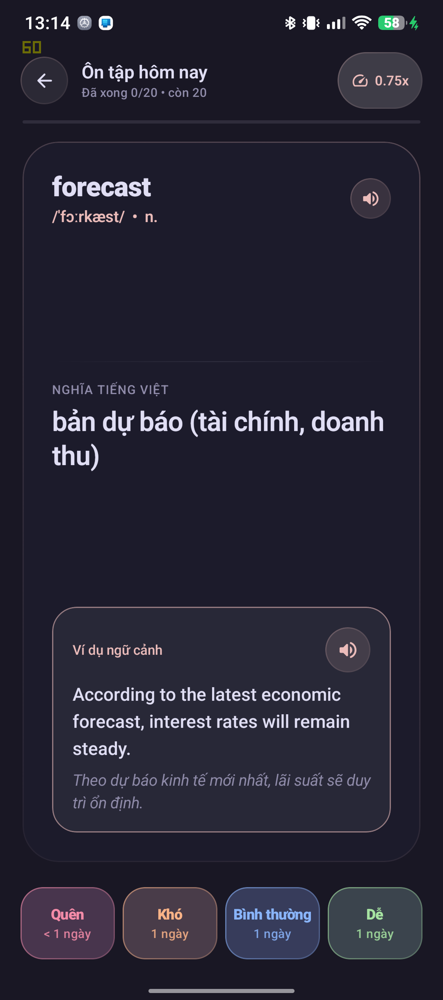</td>
  </tr>
  <tr>
    <td align="center"><sub><b>Trang chủ • Light Ice Mesh</b></sub></td>
    <td align="center"><sub><b>Trang chủ • OLED Obsidian</b></sub></td>
    <td align="center"><sub><b>Flashcard SM-2 • Light</b></sub></td>
    <td align="center"><sub><b>Flashcard SM-2 • Dark</b></sub></td>
  </tr>
</table>

</div>

---

## 🎬 Video giới thiệu (30s • 60fps) & App Icon Liquid Glass v3

<table>
  <tr>
    <th width="36%">Video Promo Showreel (1080×1920 • 60fps)</th>
    <th width="64%">App Icon Adaptive v3 — Lexora Glass Monogram (API 24–35)</th>
  </tr>
  <tr>
    <td align="center">
      <a href="media/toeic_flashcard_promo_30s.mp4">
        
      </a>
      <br />
      <sub><a href="media/toeic_flashcard_promo_30s.mp4"><b>▶ Xem / Tải Video MP4 60fps (30s)</b></a></sub>
    </td>
    <td align="center">
      
      <br />
      <sub>Adaptive Icon v3 "Lexora Glass Monogram" chiếm 70% Safe Zone, hỗ trợ Squircle / Circle / Rounded Square / Monochrome API 33+</sub>
    </td>
  </tr>
</table>

---

## ✨ Tính năng nổi bật (Cập nhật v1.4.0 — Lexora)

- **Nhận diện thương hiệu Lexora & App Icon v3:** Tên hiển thị Launcher gọn gàng (`Lexora`), Header/About kèm phụ đề `TOEIC Vocabulary • SM-2`, Adaptive Icon v3 phóng to 70% Safe Zone (giữ nguyên `applicationId = "com.toeicflashcard"` để cập nhật đè không mất dữ liệu học).
- **Màn hình Chủ đề riêng (`DeckTopicsScreen`) với Floating Search Glass:** Khi chọn bộ từ / bấm `Tiếp tục học ->`, điều hướng sang màn hình `DeckTopicsRoute` toàn màn hình; thanh tìm kiếm `LiquidGlassSearchCapsule` trôi lên thả nổi khi cuộn, tuân theo độ mờ & độ trong suốt trong Cài đặt, kèm ngưỡng cuộn ngược `52.dp` chống tụt nhầm và tối ưu GPU không render blur thừa.
- **4 Kho học liệu chuẩn hóa — 2.154+ từ vựng / 104 chủ đề:** Chuyển đổi tức thì qua **Deck Dropdown Switcher** (`DeckSwitcherSheet`) giữa *600 Từ TOEIC Cốt Lõi*, *775 Từ TOEIC Mở Rộng*, *800 Từ TOEIC Nâng Cao* và *Từ Vựng Của Tôi* — đồng bộ tên gọi xuyên suốt Home, Kho từ, Luyện tập & Thống kê.
- **Chu trình học lõi & Kho từ nâng cao (Phases 1–4):** Hỗ trợ **Hoàn tác (Undo)** lượt đánh giá SM-2 vừa bấm, thẻ **`SessionSummaryCard`** tổng kết phiên học, **`WordDetailSheet`** (sửa, xóa, đánh dấu sao `★ isStarred`, đặt lại tiến độ SM-2), **`OnboardingSheet`** cho người mới, và **`ReminderBootReceiver`** tự khôi phục lịch nhắc nhở sau khi khởi động lại máy.
- **Tinh gọn UX theo Progressive Disclosure & Tablet Landscape (`>= 900.dp`):** Giảm trùng lặp nút theo đặc tả [`docs/UI_AUDIT_BLUEPRINT.md`](./docs/UI_AUDIT_BLUEPRINT.md); trên Tablet ngang (như Redmi Pad 2 16:10), `HomeScreen` hiển thị hàng 4 bộ từ + lưới chủ đề 3 cột trực tiếp, còn `StudyScreen` kích hoạt bố cục 2 cột ngang (`68%` Flashcard 3D + `32%` cột 4 nút SM-2).
- **Thẻ Flashcard 3D Liquid Glass & Phát âm ngoại tuyến TTS:** Hiệu ứng lật `rotationY` 3D mượt mà (`graphicsLayer`, `tween 480ms`). Mặt trước tối giản với chủ đề, loại từ, IPA và nút loa TTS (`0.75x` / `1.0x`); mặt sau bố trí 3 tầng cân đối gồm từ chính kèm loa `36.dp`, nghĩa tiếng Việt và khung **Ví dụ ngữ cảnh** tương phản cao kèm loa đọc câu ví dụ.
- **Thanh đánh giá SM-2 sắc nét (`Quên • Khó • Bình thường • Dễ`):** Tính toán thời điểm ôn lại tối ưu kèm nhãn xem trước khoảng lặp (`< 1 ngày`, `1 ngày`, `6 ngày`, `N tháng`/`năm`), kết hợp **Daily Streak**, mục tiêu ngày (`5`/`10`/`20` từ) và lịch sử ôn tập 14 ngày.
- **Collapsible Top Bar + Sticky Floating Search Pill (phong cách iOS Safari):** Khi cuộn xuống danh sách Trang chủ hoặc Kho từ, hàng tiêu đề trên cùng và khung nền mờ dần rồi trượt ẩn mượt mà, nhường chỗ cho **viên thuốc kính Search (`CircleShape`, `hazeChild 18.dp`)** thu hẹp lơ lửng ngay dưới status bar đồng bộ với tự ẩn của `LiquidGlassBottomDock`.
- **Hệ sinh thái Apple Liquid Glass đa chủ đề:** Hỗ trợ chế độ **Hệ thống / Sáng (Light Ice Mesh) / Tối**, **7 không gian học tập tối (Dark Presets)** chống lóa mắt (*Đen OLED*, *Catppuccin Mocha*, *Tokyo Night*, *Nord Bắc Cực*, *Rosé Pine*, *Gruvbox Ấm*, *GitHub Dark*) và thanh trượt **Độ đục kính thời gian thực** (`45% – 95%`).
- **Kho từ tối giản & Tự thêm từ theo Progressive Disclosure:** Lọc nhanh qua duy nhất 1 hàng 4 chip trạng thái (`Tất cả`, `Hay quên`, `Đang học`, `Đã thuộc`), mở rộng ví dụ ngay trên từng thẻ từ, và thêm từ cá nhân bằng tay hoặc import hàng loạt từ tệp `.json` qua SAF (`ActivityResultContracts.OpenDocument`).
- **Trung tâm Luyện tập & Thống kê trực quan:** Trắc nghiệm nhanh 10 câu và **Luyện nghe phản xạ TTS** (ẩn mặt chữ, tự động phát âm) với nút đưa toàn bộ từ sai vào hàng đợi ôn tập gấp; thống kê Canvas 7 ngày gần nhất, tiến độ theo từng giáo trình, 8 nhóm chủ đề và Top từ khó nhớ (`easeFactor` thấp nhất).
- **Single-Card SM-2 Hero Dashboard & Lối tắt "Tiếp tục":** Tách bạch rõ `reviewDueCount` (từ đã học đến hạn ôn) khỏi `newWordsCount` (từ mới chưa học) ngay trên thẻ mục tiêu ngày (`Đến hạn • Mới • Thuộc`), kết hợp huy hiệu Streak, nút CTA động và lối tắt `Tiếp tục: [Chủ đề] (X/Y) ›` cho bài đang học dở.
- **0-Hardcode Dynamic Counts:** Toàn bộ nhãn số lượng từ vựng và chủ đề trên Trang chủ, ô Tìm kiếm, Kho từ, Luyện tập và Thống kê đều truy vấn trực tiếp từ Room Database theo thời gian thực.
- **Nhắc nhở hàng ngày (`WorkManager`), Tối ưu 120Hz ARR & Kiểm tra cập nhật:** Xin quyền thông báo `POST_NOTIFICATIONS` trên Android 13+, chọn giờ nhắc qua `TimePicker`; tự chọn `Display.Mode` tần số cao nhất trên thiết bị hỗ trợ `120Hz` với `isFrameRatePowerSavingsBalanced`. Hỗ trợ nút **`Phiên bản v1.3.0 • Kiểm tra cập nhật`** ngay cuối Cài đặt dùng `HttpURLConnection` thuần kiểm tra GitHub Releases **chỉ khi người dùng chủ động bấm**.

---

## 🖥️ Giao diện thích ứng (Phone • Foldable • Tablet)

Ứng dụng sử dụng hệ thống phân loại cửa sổ 2 trục (`AppWindowMetrics`) và khoảng thở động chuẩn iPadOS (`AdaptiveLayout.kt`) để giữ độ gọn gàng trên điện thoại nhưng vẫn sang trọng, thoáng mắt trên màn hình gập và Tablet:

| Kích thước màn hình | Khoảng thở ngang (`screenHorizontalPadding`) | Khoảng cách khối & Lưới | Số cột chủ đề | Khung Flashcard / Quiz |
| --- | :---: | :---: | :---: | :---: |
| **Điện thoại / Màn phụ** (`< 600.dp`) | `16.dp` | `14.dp` / `10.dp` | `1 cột` | `560.dp` / `580.dp` |
| **Galaxy Z Fold / Tablet dọc** (`600–999.dp`) | `28.dp` | `22.dp` / `16.dp` | `2 cột` | `720.dp` / `700.dp` |
| **Tablet xoay ngang** (`>= 1000.dp`) | `40.dp` + căn giữa `1100.dp` | `22.dp` / `16.dp` | `3 cột` | `720.dp` / `700.dp` (hoặc 2-pane khi `height < 650.dp`) |

---

## 📱 Thư viện giao diện thực tế (Light Mode vs Dark Mode)

> Toàn bộ ảnh chụp màn hình bên dưới được ghi trực tiếp từ ứng dụng chạy trên thiết bị thực (**TECNO CLA5** — Android 16, `1080×2436`, 120Hz ARR).

### 1. Trang chủ, Sticky Floating Search Pill & Chọn bộ từ

<table>
  <tr>
    <th width="33%">Trang chủ (Mở rộng)</th>
    <th width="33%">Sau khi cuộn (Floating Search Pill)</th>
    <th width="33%">Chọn giáo trình (Deck Switcher)</th>
  </tr>
  <tr>
    <td align="center"></td>
    <td align="center">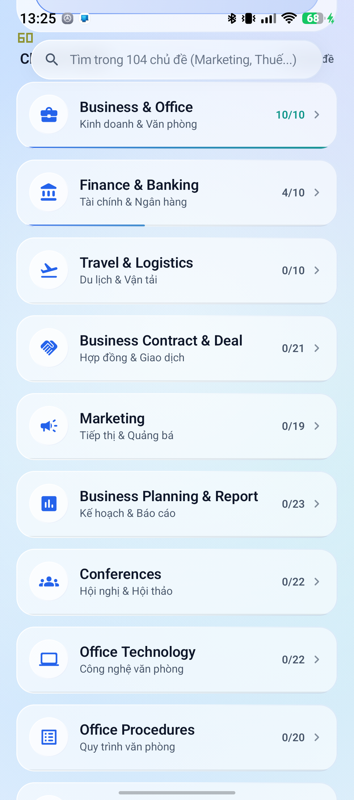</td>
    <td align="center">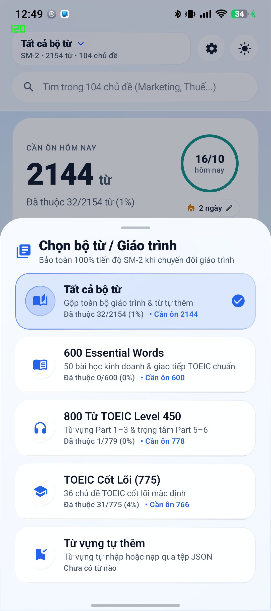</td>
  </tr>
  <tr>
    <td align="center"></td>
    <td align="center">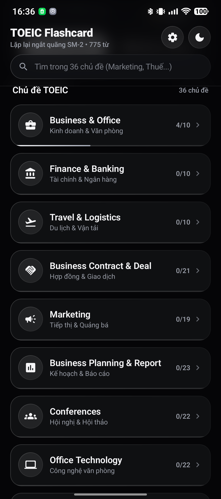</td>
    <td align="center">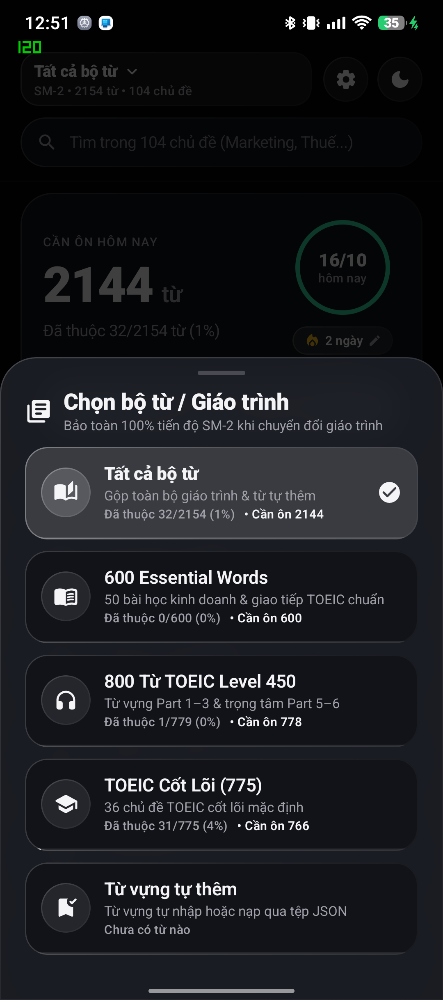</td>
  </tr>
</table>

### 2. Học Flashcard 3D, Luyện tập & Kiểm tra trắc nghiệm

<table>
  <tr>
    <th width="25%">Flashcard Mặt trước</th>
    <th width="25%">Flashcard Mặt sau & SM-2</th>
    <th width="25%">Tab Luyện tập</th>
    <th width="25%">Trắc nghiệm nhanh</th>
  </tr>
  <tr>
    <td align="center">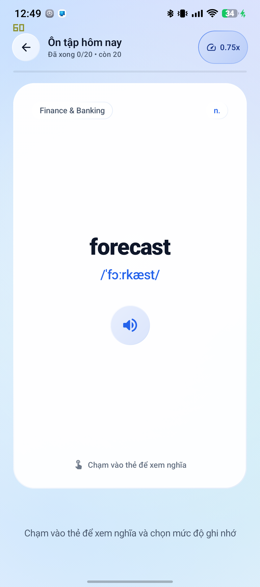</td>
    <td align="center"></td>
    <td align="center">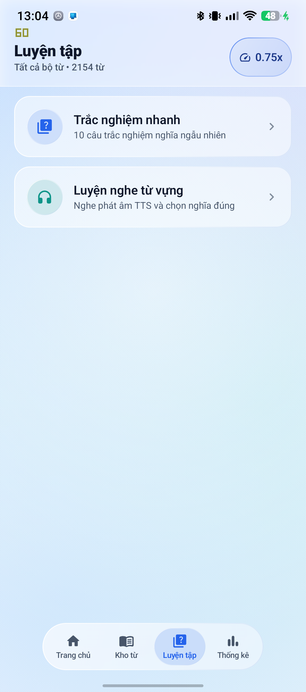</td>
    <td align="center">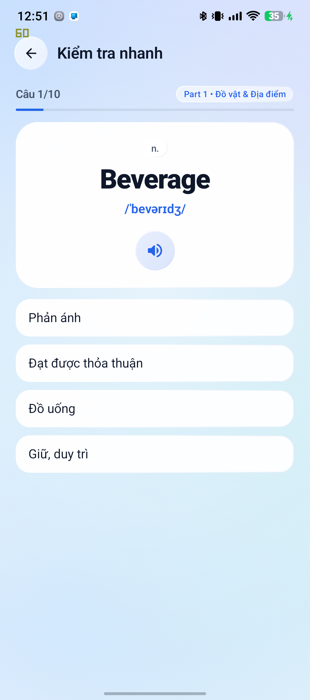</td>
  </tr>
  <tr>
    <td align="center">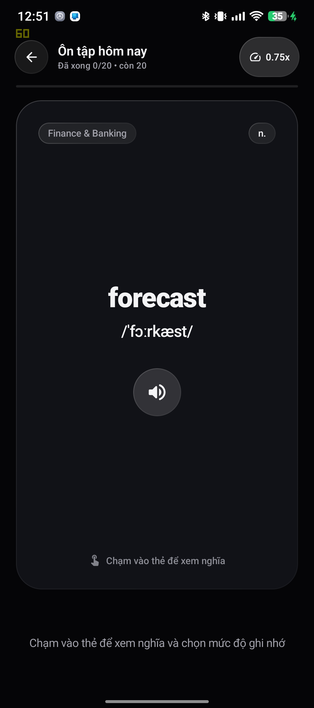</td>
    <td align="center"></td>
    <td align="center">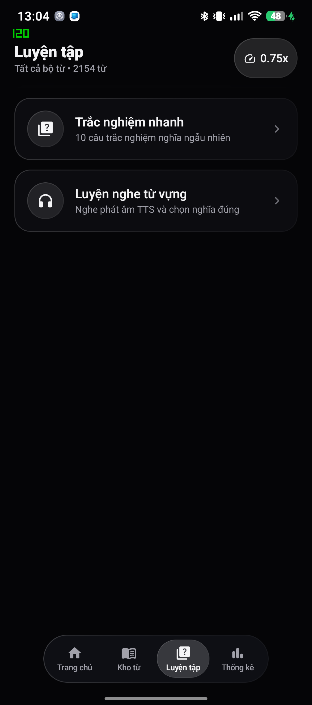</td>
    <td align="center">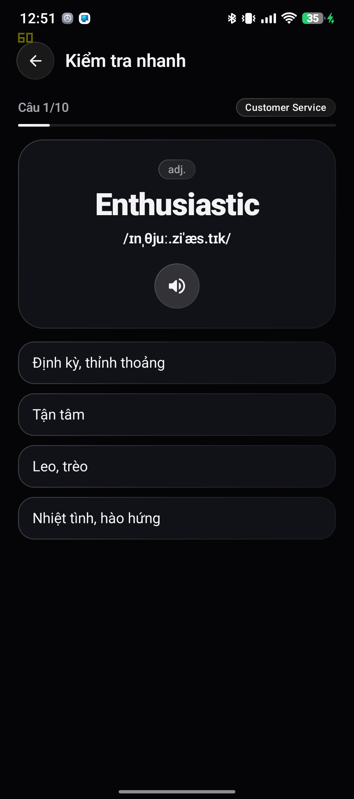</td>
  </tr>
</table>

### 3. Kho từ vựng, Thêm từ mới, Thống kê & Cài đặt không gian học

<table>
  <tr>
    <th width="25%">Kho từ vựng</th>
    <th width="25%">Thêm từ vựng mới</th>
    <th width="25%">Thống kê học tập</th>
    <th width="25%">Cài đặt & Dark Presets</th>
  </tr>
  <tr>
    <td align="center">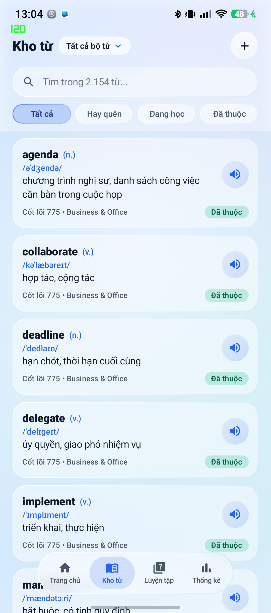</td>
    <td align="center">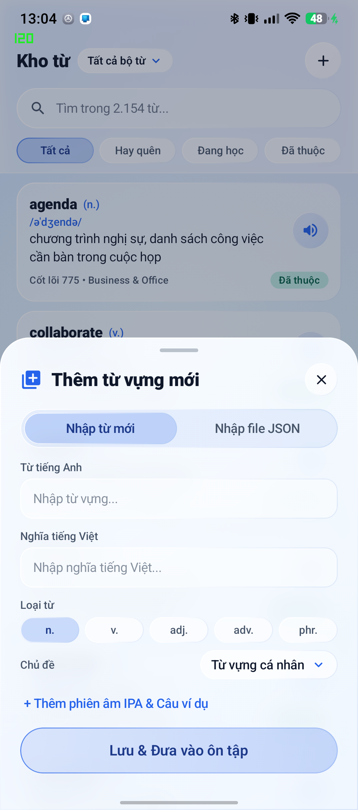</td>
    <td align="center"></td>
    <td align="center">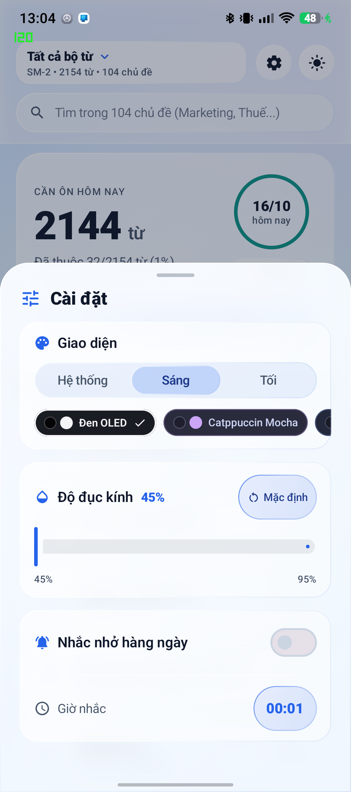</td>
  </tr>
  <tr>
    <td align="center">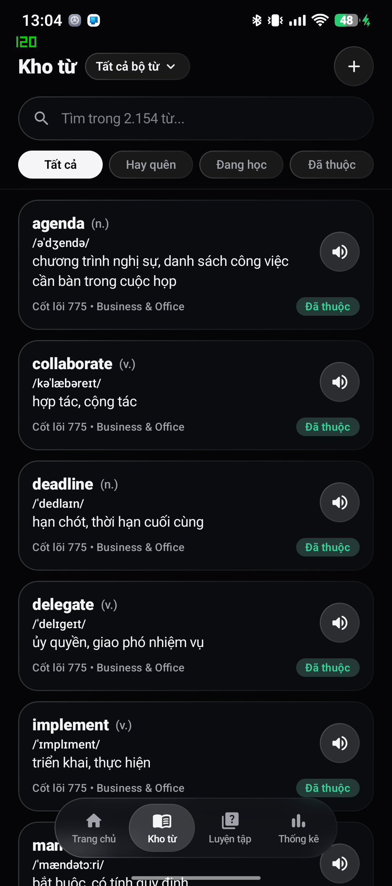</td>
    <td align="center">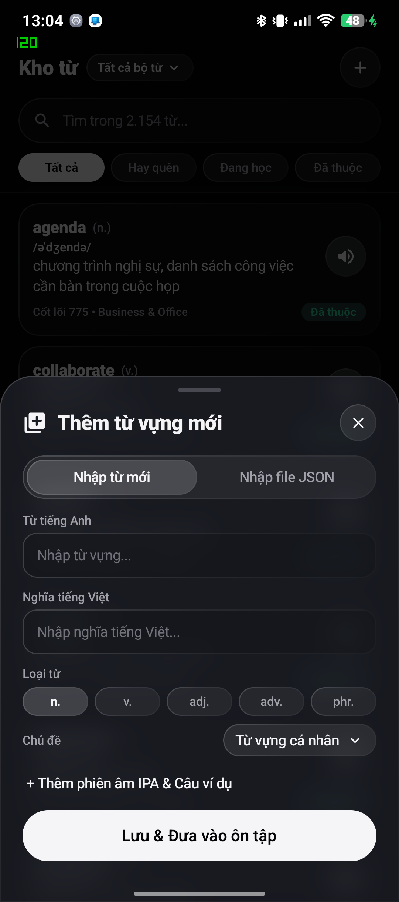</td>
    <td align="center"></td>
    <td align="center">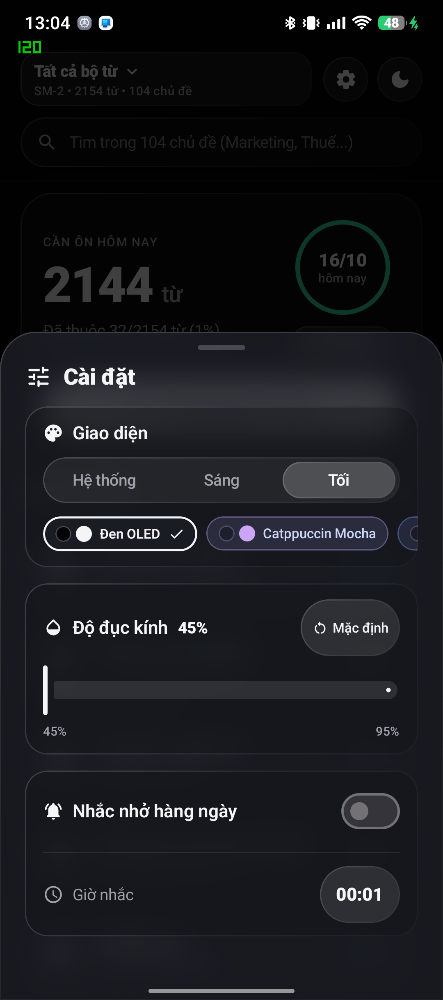</td>
  </tr>
</table>

---

## 📚 Kho dữ liệu 2.154+ từ vựng

Dữ liệu mặc định được đóng gói sẵn trong `app/src/main/assets/` và nạp bất biến (idempotent) qua `VocabularySeeder` (`SEED_VERSION = 3`) sử dụng `Mutex` cùng `MIGRATION_2_3` bảo toàn 100% lịch ôn SM-2 hiện có:

| `deckId` | Tên bộ từ hiển thị | Số lượng | Phạm vi ID & Chủ đề | Nguồn dữ liệu |
| --- | --- | :---: | --- | --- |
| `ALL` | **Tất cả bộ từ** | **2.154+ từ** | Gộp mọi giáo trình + từ tự thêm (`104+` chủ đề) | Tổng hợp Room |
| `essential_600` | **600 Essential Words** | **600 từ** | ID `1001..1600` • `50` bài học (mỗi bài 12 từ) | `deck_essential_600.json` |
| `level_450_800` | **800 Từ TOEIC Level 450** | **779 từ** | ID `2001..2779` • `18` chủ đề Part 1–3 & Part 5–6 | `deck_level_450_800.json` |
| `core_775` | **TOEIC Cốt Lõi (775)** | **775 từ** | ID `1..775` • `36` chủ đề TOEIC cốt lõi | `toeic_vocab.json` (30) + `toeic_vocab_600.json` (745) |
| `custom_user` | **Từ vựng tự thêm** | Động | ID `>= 3001` (nhập tay hoặc import file JSON) | Người dùng tạo |

---

## 🏗️ Kiến trúc hệ thống & Công nghệ

Ứng dụng tuân theo **Clean Architecture 3 tầng** kết hợp **MVVM** và **Manual DI** qua [`AppContainer.kt`](app/src/main/java/com/toeicflashcard/di/AppContainer.kt), cô lập hoàn toàn quy tắc nghiệp vụ Kotlin thuần khỏi Android SDK.

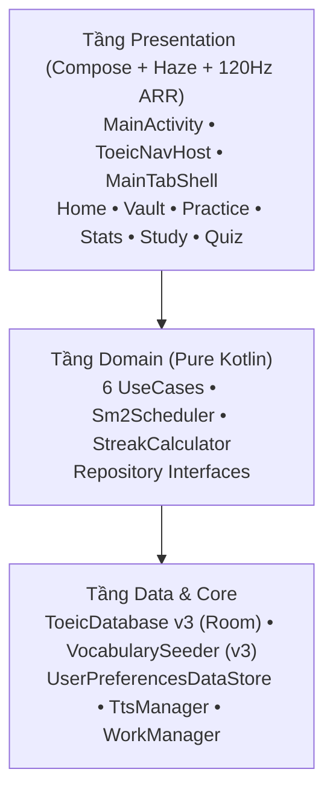

### Cấu trúc thư mục mã nguồn (`app/src/main/java/com/toeicflashcard/`)

```text
com/toeicflashcard/
├── MainActivity.kt                  # Edge-to-Edge, Theme/DarkTone observer, enableAdaptiveHighRefreshRate()
├── ToeicApplication.kt              # Khởi tạo AppContainer vòng đời Application
├── di/
│   └── AppContainer.kt              # Manual DI cho Database, Repositories, Schedulers & 6 UseCases
├── core/
│   ├── audio/TtsManager.kt          # Lazy off-main-thread TextToSpeech (Locale.US -> ENGLISH, 0.75x / 0.95x)
│   ├── notification/                # ReminderNotificationHelper & WorkManagerReminderScheduler
│   ├── time/TimeProvider.kt         # Chuẩn hóa epochDay & endOfTodayMillis từ API 24+
│   └── ui/
│       ├── glass/                   # AmbientMeshBackground, LiquidGlassComponents, LiquidGlassBottomDock, CollapsibleHeaderState
│       └── theme/                   # Color.kt, Theme.kt (LocalLiquidGlassColors, LocalSm2RatingColors), Type.kt
├── data/
│   ├── local/                       # VocabularyEntity, VocabularyDao, ToeicDatabase v3, VocabularySeeder, UserPreferencesDataStore
│   ├── mapper/                      # VocabularyMapper (Entity <-> Domain)
│   ├── model/                       # SeedVocabularyDto
│   ├── repository/                  # VocabularyRepositoryImpl (In-memory cache), UserPreferencesRepositoryImpl
│   └── worker/DailyReminderWorker.kt
├── domain/
│   ├── model/                       # VocabularyWord, VocabularyDecks, UserPreferences (DarkTone), ReviewQuality, QuizModels
│   ├── repository/                  # Interfaces cho Vocabulary & UserPreferences
│   ├── scheduler/Sm2Scheduler.kt    # Thuật toán SuperMemo-2 thuần Kotlin
│   ├── streak/StreakCalculator.kt   # Tính chuỗi ngày học & lịch sử 14 ngày
│   └── usecase/                     # ObserveHomeSummary, GetStudyQueue, SubmitReview, GenerateQuiz, MarkWordsUrgentReview, AddCustomVocabulary
└── presentation/
    ├── navigation/ToeicNavHost.kt   # Warm MainTabShell + StudyRoute/QuizRoute overlays
    ├── main/MainTabShell.kt         # Single HazeSource + CollapsibleHeaderState + Dock + In-window Sheets
    ├── home/                        # HomeScreen, HomeViewModel, TopicVisuals + Hero/DeckSwitcher/AddVocab/QuizScope/Reminder components
    ├── vault/                       # VocabularyVaultScreen & VocabularyVaultViewModel
    ├── practice/                    # PracticeScreen
    ├── stats/                       # StatsScreen & StatsViewModel
    ├── study/                       # StudyScreen, StudyViewModel, Flashcard3D, Sm2RatingBar
    └── quiz/                        # QuizScreen, QuizViewModel, QuizUiState
```

### Công nghệ sử dụng

| Nhóm | Thư viện / Công nghệ | Phiên bản | Vai trò |
| --- | --- | --- | --- |
| **Ngôn ngữ & Build** | Kotlin / AGP / Google KSP | `2.0.21` / `8.7.3` / `2.0.21-1.0.28` | Build `debug`, `release`, `benchmark`; JVM 17; Android API `24..35` |
| **Giao diện & Kính mờ** | Jetpack Compose BOM / Material 3 / `dev.chrisbanes.haze:haze` | `2024.12.01` / `1.0.0` | UI khai báo, `LazyColumn`, lật thẻ 3D & hiệu ứng kính mờ thời gian thực `hazeChild` |
| **Lưu trữ cục bộ** | Room SQLite (`room-runtime`, `room-ktx`) / DataStore Preferences | `2.6.1` / `1.1.1` | 2.154+ từ vựng & lịch SM-2 (`ToeicDatabase v3`) và tùy chọn giao diện/nhắc nhở |
| **Điều hướng & Serialization** | `navigation-compose` / `kotlinx-serialization-json` | `2.8.5` / `1.7.3` | Type-safe Routes (`HomeRoute`, `StudyRoute`, `QuizRoute`) & parse JSON seed/import |
| **Bất đồng bộ & Tác vụ nền** | `kotlinx-coroutines-android` / `work-runtime-ktx` | `1.9.0` / `2.10.0` | Coroutines / `StateFlow` / `DailyReminderWorker` nhắc ôn định kỳ mỗi 24 giờ |
| **Kiểm thử** | `junit:junit` / `kotlinx-coroutines-test` | `4.13.2` / `1.9.0` | Bộ unit test cho SM-2, Streak, Queue, Quiz, Custom Import, Refresh Rate & DarkTone |

---

## 🧠 Thuật toán SM-2 & 7 Không gian học tập tối

### Thang đánh giá SuperMemo-2 (`ReviewQuality`)

| Nút đánh giá | Giá trị `q` | Ý nghĩa & Chu kỳ lặp tiếp theo (`Sm2Scheduler.kt`) |
| :--- | :---: | :--- |
| **Quên** | `1` | Reset `repetitions = 0`, đẩy thẻ về cuối hàng đợi trong phiên hiện tại cho tới khi nhớ lại |
| **Khó** | `3` | Giảm nhẹ hệ số dễ `EF`, ôn lại sau `1 ngày` (lần đầu) hoặc `6 ngày` (lần 2) |
| **Bình thường** | `4` | Duy trì nhịp chuẩn SM-2: `1 ngày` → `6 ngày` → `round(interval * EF') ngày` |
| **Dễ** | `5` | Tăng hệ số dễ `EF'` giúp giãn khoảng thời gian ôn tập nhanh hơn cho từ đã vững |

$$EF' = \max\!\left(1.3,\; EF + 0.1 - (5 - q)\bigl(0.08 + 0.02(5 - q)\bigr)\right)$$

### 7 bảng màu Dark Mode (`DarkTone`)

| Tên hiển thị | ID Preset | Nền chính | Thẻ kính | Sheet / Dialog | Điểm nhấn (`Accent`) |
| --- | --- | :---: | :---: | :---: | :---: |
| **Đen OLED** | `oled_obsidian` | `#050507` | `#121318` | `#1A1C23` | `#F5F5F7` |
| **Catppuccin Mocha** | `catppuccin_mocha` | `#1E1E2E` | `#2A2B3D` | `#313244` | `#CBA6F7` |
| **Tokyo Night** | `tokyo_night` | `#1A1B26` | `#24283B` | `#292E42` | `#7AA2F7` |
| **Nord Bắc Cực** | `nord_arctic` | `#2E3440` | `#3B4252` | `#434C5E` | `#88C0D0` |
| **Rosé Pine** | `rose_pine` | `#191724` | `#1F1D2E` | `#26233A` | `#EBBCBA` |
| **Gruvbox Ấm** | `gruvbox_dark` | `#282828` | `#32302F` | `#3C3836` | `#FABD2F` |
| **GitHub Dark** | `github_dark` | `#0D1117` | `#161B22` | `#1F242C` | `#58A6FF` |

---

## ⚡ Hiệu năng 120Hz ARR & Hành vi cuộn iOS

- **Adaptive Refresh Rate (`MainActivity.kt`):** Tự động chọn `Display.Mode` khớp độ phân giải có `refreshRate` cao nhất (ví dụ `120Hz`) trên Android 11+ (API 30+), đồng thời bật `isFrameRatePowerSavingsBalanced = true` và `frameRateBoostOnTouchEnabled = true` trên Android 15+ (API 35+) để hạ về `60Hz`/`1Hz` khi màn hình đứng yên.
- **Zero Idle Loop Animations:** Không sử dụng `rememberInfiniteTransition` hay bitmap tái tạo theo từng khung hình; hình nền Ice Mesh được rasterize một lần theo kích thước màn hình.
- **Draw-phase Collapsible Header & Dock:** Cả `CollapsibleHeaderState` và `LiquidGlassBottomDock` đều hoạt động trên `graphicsLayer` (`translationY`, `alpha`, `shadowElevation`) và `.layout`, hoàn toàn không gây recomposition trong lúc cuộn.

---

## 🛠️ Hướng dẫn Build, Kiểm thử & Import JSON

### Yêu cầu môi trường
- **JDK 17** trở lên
- **Android Studio Ladybug+** & **Android SDK 35** (hoặc Command-line Tools)

### Các lệnh Build, Test & Cài đặt ADB

```powershell
# 1. Clone dự án
git clone https://github.com/NgocTanHoang/Toeic_Flashcard_Android.git
cd Toeic_Flashcard_Android

# 2. Chạy toàn bộ unit test và đóng gói bản Release có ký số & tối ưu R8
./gradlew.bat testDebugUnitTest assembleRelease

# 3. Cài đặt bản Debug lên thiết bị / máy ảo đang kết nối ADB
./gradlew.bat installDebug
```

> **Cài đặt nhanh cho người dùng:** Tải trực tiếp file `Lexora-v1.4.0.apk` tại trang [**GitHub Releases**](https://github.com/NgocTanHoang/Toeic_Flashcard_Android/releases/latest). Các bản cập nhật ký chung keystore giữ nguyên **100% dữ liệu SM-2 và từ tự thêm** khi cài đè.

### Chạy thử nghiệm đa thiết bị Low-RAM (`Q1`–`Q11`, trần `<= 2.0 GB` RAM)
Dự án đi kèm bộ launcher [`Start_Emulator.bat`](./Start_Emulator.bat) / [`tools/launch_toeic_avd.ps1`](./tools/launch_toeic_avd.ps1) hỗ trợ chuyển nhanh 11 cấu hình màn hình thực tế (TECNO CLA5, Galaxy Z Fold 7/8 Cover & Inner, OPPO Pad SE, Redmi Pad 2 dọc/ngang, Xiaomi Pad 8, Split-Screen) mà chỉ dùng 1 máy ảo nền (`-memory 1152 -gpu swiftshader_indirect`).

### Định dạng `.json` hỗ trợ Import vào `Từ vựng tự thêm`

Trong tab **Kho từ** -> nhấn nút **`+`** -> chuyển sang tab **Nhập file JSON** và chọn tệp `.json` có cấu trúc:

```json
[
  {
    "word": "synergy",
    "phonetic": "/ˈsɪnərdʒi/",
    "partOfSpeech": "n.",
    "meaningVi": "hợp lực, sức mạnh cộng hưởng",
    "topic": "Chiến lược",
    "exampleEn": "The merger created strong operational synergy.",
    "exampleVi": "Thương vụ sáp nhập đã tạo ra sức mạnh cộng hưởng vận hành lớn."
  }
]
```

> Chỉ hai trường `word` và `meaningVi` là bắt buộc; các trường còn lại có thể bỏ trống. Ứng dụng tự xử lý UTF-8 BOM, bỏ qua từ trùng lặp và xếp từ mới vào hàng đợi ôn hôm nay.

---

## 📄 Tài liệu kiến trúc & kỹ thuật

- **[`docs/TECHNICAL_DOCUMENTATION.md`](./docs/TECHNICAL_DOCUMENTATION.md)** — Đặc tả kỹ thuật chi tiết (`v1.4.0`): Clean Architecture, SM-2 (`reviewDueCount` vs `newWordsCount`), `DeckTopicsScreen` + `CollapsibleHeaderState`, Ma trận Adaptive UI 11 thiết bị (`Q1`–`Q11`), Room v4 & CI/CD.
- **[`docs/UI_AUDIT_BLUEPRINT.md`](./docs/UI_AUDIT_BLUEPRINT.md)** — Đặc tả kiểm toán giao diện, sơ đồ luồng người dùng Mermaid & ASCII wireframe dùng để tinh gọn Progressive Disclosure.
- **[`PROJECT_REPORT.md`](./PROJECT_REPORT.md)** — Báo cáo tổng hợp 14 Use Cases, Sequence Diagrams, Lược đồ CSDL, Máy trạng thái và Kết quả kiểm thử toàn dự án.
