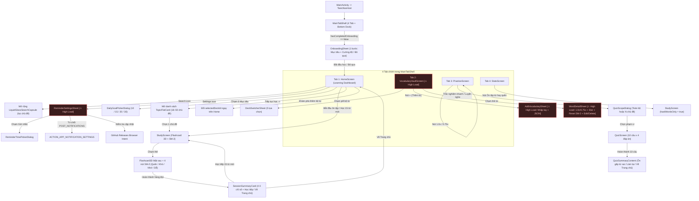

# Lexora — UI/UX Audit Blueprint (Source-Verified)

> Tài liệu đặc tả trực quan được trích xuất trực tiếp từ mã nguồn Compose hiện tại trong `app/src/main/java/com/toeicflashcard/presentation/` (không suy đoán thành phần chưa tồn tại).

---

## 1. Sơ đồ Luồng người dùng tổng thể (`flowchart TD`)

> Các nút gắn nhãn **`[⚠ High Load]`** là các điểm người mới dễ bị ngợp bởi nhiều lớp overlay, rẽ nhánh sâu hoặc mật độ tùy chọn cao.



---

## 2. Bản vẽ ASCII Wireframe chi tiết & Đo lường mật độ

### 2.1 `HomeScreen` (có dữ liệu học, chưa có dữ liệu, & `OnboardingSheet`)

#### A. Trạng thái bình thường (có dữ liệu học — mặc định `showActiveDeckTopics = false`)
```text
+-------------------------------------------------------------------+
| [BookIcon] Lexora                     [SearchBtn]  [SettingsBtn]  | <- FloatingGlassHomeHeader
|            TOEIC Vocabulary • SM-2                                |
| (Khi bấm Search: [ LiquidGlassSearchCapsule (Query / Clear)    ]) |
+-------------------------------------------------------------------+
| +---------------------------------------------------------------+ |
| | TIẾN ĐỘ HÔM NAY                        Đạt mục tiêu • 100%    | | <- HeroGlassDashboard (Liquid Glass)
| | +---------------+   +---------------+   +-------------------+ | |
| | |      12       |   |       8       |   |    15 [EditIcon]  | | | <- 3 Metric Tiles (Mục tiêu -> Dialog)
| | |    Cần ôn     |   |    Đã học     |   |     Mục tiêu      | | |
| | +---------------+   +---------------+   +-------------------+ | |
| | [========================------------------]                  | | <- DailyProgressBar
| | [  ▶  Bắt đầu ôn tập (12 từ)  (hoặc Học 15 từ mới)          ] | | <- Primary Action
| +---------------------------------------------------------------+ |
|                                                                   |
| Bộ từ vựng của bạn                                  50 chủ đề (*) | <- Subtitle bấm được để mở/ẩn bài
| +---------------------------------------------------------------+ |
| | 600 Từ TOEIC Cốt Lõi                                      7%  | | <- MyDeckFlatCard (Flat Surface 14dp)
| | 50 chủ đề nền tảng thiết yếu cho mục tiêu 500–650+ TOEIC      | |
| | [====-------------------------------------------------------] | |
| | 44 / 600 từ đã học                          Tiếp tục học ->   | |
| +---------------------------------------------------------------+ |
| (Khi bấm Tiếp tục học ->: Lưới TopicFlatCard 1..3 cột bên dưới)   |
|                                                                   |
| Khám phá thêm bộ từ                                    3 lộ trình |
| +---------------------------------------------------------------+ |
| | 775 Từ TOEIC Mở Rộng                                      [>] | | <- DiscoverDeckFlatCard (Flat 14dp)
| | 36 chủ đề giao tiếp công sở & thương mại mở rộng              | |
| | [==---------------------------------------------------------] | |
| | 24 / 775 từ                                               3%  | |
| +---------------------------------------------------------------+ |
| | 800 Từ TOEIC Nâng Cao | Từ Vựng Của Tôi ...                   | |
+-------------------------------------------------------------------+
|        ( Trang chủ | Kho từ | Luyện tập | Thống kê )              | <- LiquidGlassBottomDock (4 tabs)
+-------------------------------------------------------------------+
```

#### B. Trạng thái chưa có dữ liệu (`totalCount == 0`, ví dụ bộ `Từ Vựng Của Tôi` trống & mở danh sách bài)
```text
+-------------------------------------------------------------------+
| [BookIcon] Lexora                     [SearchBtn]  [SettingsBtn]  |
+-------------------------------------------------------------------+
| +---------------------------------------------------------------+ |
| | TIẾN ĐỘ HÔM NAY                             0% mục tiêu       | |
| |   [  0 Cần ôn  ]    [  0 Đã học  ]    [  15 Mục tiêu ✎  ]     | |
| |   [-------------------------------------------------------]   | |
| |   [  ✓  Đã hoàn thành hôm nay (Disabled)                  ]   | |
| +---------------------------------------------------------------+ |
| Bộ từ vựng của bạn                                    0 chủ đề    |
| +---------------------------------------------------------------+ |
| | Từ Vựng Của Tôi                                           0%  | |
| | Bộ từ vựng cá nhân bạn tự thêm và quản lý riêng               | |
| | 0 / 0 từ đã học                             Tiếp tục học ->   | |
| +---------------------------------------------------------------+ |
| (Khi mở Tiếp tục học -> trên bộ trống:)                           |
| +---------------------------------------------------------------+ |
| | Bộ từ "Từ Vựng Của Tôi" chưa có từ vựng nào. Hãy sang tab Kho | |
| | từ bấm nút + để thêm từ mới.                                  | |
| +---------------------------------------------------------------+ |
+-------------------------------------------------------------------+
```

- **Tổng số điểm chạm/nút tương tác trên 1 khung hình (Home mặc định):** **12 điểm chạm** (`Search`, `Settings`, ô `Mục tiêu`, `Primary CTA`, subtitle `N chủ đề`, `MyDeckFlatCard`, `3 DiscoverDeckFlatCard`, `4 tab Bottom Dock` — tăng lên **30–62 điểm chạm** khi bung danh sách chủ đề).
- **Số lớp hộp/card lồng nhau:** **3 lớp** (`MainTabShell Haze Box` → `HeroGlassDashboard / FlatSurfaceCard` → `OverviewMetricTile`).

---

### 2.2 `StudyScreen` (Mặt trước, Mặt sau Flashcard 3D & `SessionSummaryCard`)

#### A. Mặt trước & Mặt sau (`Flashcard3D` + `StudyTopBar` + `Sm2RatingBar`)
```text
+-------------------------------------------------------------------+
| [ <- ]  600 Từ TOEIC Cốt Lõi         [VolOn/Off]  [Speed 1.0x]    | <- StudyTopBar
|         Đã xong 2/15 • còn 13                                     |
| [========-------------------------------------------------------] | <- Hairline Progress
+-------------------------------------------------------------------+
|  MẶT TRƯỚC (isFlipped = false)     |  MẶT SAU (isFlipped = true)  |
|  +------------------------------+  |  +------------------------+  |
|  | [Contracts]           [v.]   |  |  | abide          [Vol]   |  |
|  |                              |  |  | /əˈbaɪd/ • v.          |  |
|  |           abide              |  |  |------------------------|  |
|  |          /əˈbaɪd/            |  |  | NGHĨA TIẾNG VIỆT       |  |
|  |                              |  |  | Tuân thủ, chấp hành    |  |
|  |         [ VolBtn ]           |  |  |                        |  |
|  |                              |  |  | +--------------------+ |  |
|  |   [Touch] Chạm để xem nghĩa  |  |  | | Ví dụ ngữ cảnh [V] | |  |
|  +------------------------------+  |  | | Abide by the law.  | |  |
|                                    |  | | Tuân thủ pháp luật.| |  |
|  [  Chạm vào thẻ để xem nghĩa  ]   |  | +--------------------+ |  |
|  (hoặc Sm2RatingBar khi đã lật)    |  +------------------------+  |
+------------------------------------+------------------------------+
|  (Khi hasRevealedBack == true:)                                   |
|  [ Quên (<1p) ]   [ Khó (1d) ]   [ Nhớ (6d) ]   [ Dễ (10d) ]      | <- 4 nút SM-2
+-------------------------------------------------------------------+
```

#### B. Màn hình kết thúc phiên (`SessionSummaryCard`)
```text
+-------------------------------------------------------------------+
| [ <- ]  600 Từ TOEIC Cốt Lõi         [VolOn/Off]  [Speed 1.0x]    |
+-------------------------------------------------------------------+
|  +-------------------------------------------------------------+  |
|  | [CelebrationIcon]                      [🔥 Streak 2 ngày ]  |  |
|  |                                                             |  |
|  |                  Tổng kết phiên học                         |  |
|  |                   Tỷ lệ nhớ: 87%                            |  |
|  |                                                             |  |
|  |  +-------------------------+   +-------------------------+  |  |
|  |  | 10                      |   | 5                       |  |  |
|  |  | Từ mới đã học           |   | Từ ôn tập               |  |  |
|  |  +-------------------------+   +-------------------------+  |  |
|  |  | 15                      |   | 13                      |  |  |
|  |  | Tổng số từ đã ôn        |   | Số từ nhớ ngay          |  |  |
|  |  +-------------------------+   +-------------------------+  |  |
|  |                                                             |  |
|  |  [  ▶  Học tiếp 15 từ mới  ] (hoặc banner Đã hoàn thành)    |  |
|  |  [      Về Trang chủ       ]                                |  |
|  +-------------------------------------------------------------+  |
+-------------------------------------------------------------------+
```

- **Tổng số điểm chạm/nút tương tác trên 1 khung hình:**
  - `StudyScreen` mặt trước: **5 điểm chạm** (`Back`, `AutoPlayToggle`, `SpeedToggle`, `Flashcard3D`, `SpeakerBtn`).
  - `StudyScreen` mặt sau: **9 điểm chạm** (`Back`, `AutoPlayToggle`, `SpeedToggle`, `Flashcard3D`, `WordSpeaker`, `ExampleSpeaker`, `4 nút SM-2`).
  - `SessionSummaryCard`: **5 điểm chạm** (`Back`, `AutoPlayToggle`, `SpeedToggle`, `Học tiếp`, `Về Trang chủ`).
- **Số lớp hộp/card lồng nhau:** **3 lớp** (`StudyScreen AmbientMesh` → `Flashcard3D / SessionSummaryCard` → `ExampleBox / SummaryStatTile`).

---

### 2.3 `VocabularyVaultScreen` + `WordDetailSheet` + `AddVocabularySheet`

#### A. `VocabularyVaultScreen`
```text
+-------------------------------------------------------------------+
| Kho từ  [ 600 Essential Words v ]                         [ + ]   | <- FloatingVaultHeader
| [ (Search) Tìm trong 600 từ...                                  ] | <- LiquidGlassSearchCapsule
| (Tất cả) (Hay quên (3)) (Đang học (556)) (Đã thuộc (44)) (Sao(1)) | <- LazyRow 5 chip lọc
+-------------------------------------------------------------------+
| +-------------------------------+ +-----------------------------+ |
| | Checking (v.)     [★] [Vol]   | | Examining (v.)  [☆] [Vol]   | | <- VaultWordCard (1–3 cột)
| | /ˈtʃekɪŋ/                     | | /ɪɡˈzæmɪnɪŋ/                | |
| | Kiểm tra                      | | Xem xét                     | |
| | 800 Nâng cao • Part 1 [Đang]  | | 800 Nâng cao • P1  [Đang]   | |
| +-------------------------------+ +-----------------------------+ |
+-------------------------------------------------------------------+
|        ( Trang chủ | Kho từ | Luyện tập | Thống kê )              |
+-------------------------------------------------------------------+
```

#### B. `WordDetailSheet` (Layer 8 — Bottom Dock tự ẩn) & `AddVocabularySheet` (Layer 5)
```text
+-------------------------------------------------------------------+
| [ WordDetailSheet ]                                               |
| Checking (v.)                                    [ ★ ]   [ × ]    |
| /ˈtʃekɪŋ/  •  800 Nâng cao • Part 1 • Hành động & Việc làm        |
| [ Vol Phát âm 1.0x ]              [ Slow Chậm 0.75x ]             |
| +---------------------------------------------------------------+ |
| | Nghĩa tiếng Việt: Kiểm tra                                    | |
| | +-----------------------------------------------------------+ | |
| | | The engineer is checking the pressure gauge.              | | |
| | | Kỹ sư đang kiểm tra đồng hồ đo áp suất.                   | | |
| | +-----------------------------------------------------------+ | |
| +---------------------------------------------------------------+ |
| +---------------------------------------------------------------+ |
| | Tiến độ SM-2                                     [Chưa thuộc] | |
| | Lặp lại: 0 • Khoảng cách: 0 ngày • Ease: 2.50                 | |
| | [ ↺ Đặt lại tiến độ SM-2 ]                                    | |
| +---------------------------------------------------------------+ |
| (Nếu deckId == "custom_user":)                                    |
| [ ✎ Chỉnh sửa (mở 7 ô nhập + 5 chip POS) ]    [ 🗑 Xóa từ -> Dialog]|
+-------------------------------------------------------------------+

[ AddVocabularySheet (Layer 5) ]
- 2 Tab: ( Nhập từ mới | Nhập file JSON )
- Tab Nhập tay: 7 ô BasicTextField (Từ*, Phiên âm, 5 chip Loại từ, Nghĩa*, Chủ đề + Dropdown gợi ý, Ví dụ EN, Ví dụ VI) + nút [Thêm từ vào Từ vựng tự thêm]
- Tab JSON: Nút [Copy mẫu JSON] + Nút [Chọn file .json] + Preview + Nút [Nhập vào kho]
```

- **Tổng số điểm chạm/nút tương tác trên 1 khung hình:**
  - `VocabularyVaultScreen`: **~20–25 điểm chạm** hiển thị cùng lúc (`DeckPill`, nút `+`, `Search`, `5 FilterChips`, `4–6 Cards × 3 nút [Card, Star, Vol]`, `4 Bottom Dock tabs`).
  - `WordDetailSheet`: **6 điểm chạm** (từ mặc định) hoặc **8 điểm chạm** (từ `custom_user`, lên tới **15 điểm chạm** khi mở form Chỉnh sửa).
- **Số lớp hộp/card lồng nhau:** **3–4 lớp** (`MainTabShell` → `LiquidGlassSheetSurface` → `LiquidGlassCard` → `ExampleBox`).

---

### 2.4 `PracticeScreen` + `QuizScopeDialog` + `QuizScreen`

```text
+-------------------------------------------------------------------+
| Luyện tập                                       [ Speed 1.0x ]    | <- FloatingPracticeHeader
| 600 Essential Words • 600 từ                                      |
+-------------------------------------------------------------------+
| +-------------------------------+ +-----------------------------+ |
| | [Quiz] Trắc nghiệm nhanh  [>] | | [Headphones] Luyện nghe [>] | | <- PracticeModeGlassCard
| | 10 câu trắc nghiệm ngẫu nhiên | | Nghe phát âm TTS & chọn     | |
| +-------------------------------+ +-----------------------------+ |
+-------------------------------------------------------------------+
|        ( Trang chủ | Kho từ | Luyện tập | Thống kê )              |
+-------------------------------------------------------------------+

[ QuizScopeDialog ] -> LiquidGlassDialogSurface:
- Nút [Toàn bộ bộ từ đang chọn] + danh sách N chủ đề (chạm -> QuizScreen)

[ QuizScreen (Active & Summary) ]
+-------------------------------------------------------------------+
| [ <- ]  Trắc nghiệm / Luyện nghe                [ Speed 1.0x* ]   | (*chỉ hiện ở ListeningMode)
| Câu 1/10   [======--------------------------------------------]   |
| +---------------------------------------------------------------+ |
| |  (Normal): Word + /IPA/ + POS + [Vol]                         | |
| |  (Listening): [  Vol Nghe phát âm (lớn)  ] + "Nghe & chọn"    | |
| +---------------------------------------------------------------+ |
| [ A. Đáp án 1 ]   [ B. Đáp án 2 ]   [ C. Đáp án 3 ]   [ D. 4 ]    |
| [ Câu tiếp theo -> / Xem kết quả ] (chỉ hiện sau khi đã chọn)     |
|-------------------------------------------------------------------|
| (QuizSummaryContent): Điểm X/10 + Tỷ lệ % + List từ làm sai [Vol] |
| + 3 nút: [⚡ Ôn gấp N từ sai], [↻ Làm lại], [Về Trang chủ]        |
+-------------------------------------------------------------------+
```

- **Tổng số điểm chạm/nút tương tác trên 1 khung hình:**
  - `PracticeScreen`: **7 điểm chạm** (`SpeedToggle`, `2 ModeCards`, `4 Bottom Dock tabs`).
  - `QuizScreen` (Active): **6–7 điểm chạm** (`Back`, optional `SpeedToggle`, optional `SpeakerBtn`, `4 OptionCards`, `NextBtn`).
- **Số lớp hộp/card lồng nhau:** **2–3 lớp** (`MainTabShell / QuizScreen` → `LiquidGlassCard` → `QuizOptionCard`).

---

### 2.5 `StatsScreen` + `ReminderSettingsSheet` (Settings)

```text
+-------------------------------------------------------------------+
| Thống kê học tập                                 [ 🔥 2 ngày ]    | <- FloatingStatsHeader
| Đã thuộc 44/600 từ (7%)                                           |
+-------------------------------------------------------------------+
| +---------------------------------------------------------------+ |
| | Tiến độ 7 ngày gần nhất                                       | | <- WeeklyBarChartGlassCard
| | 10   0   15   20   5   12   8   [ Biểu đồ cột + đường Goal ]  | |
| +---------------------------------------------------------------+ |
| +-------------------------------+ +-----------------------------+ |
| | Độ thành thạo theo Bộ từ      | | Thành thạo theo Chủ đề      | |
| | 4 thanh tiến độ từng Deck     | | Top 4 chủ đề + tiến độ %    | |
| +-------------------------------+ +-----------------------------+ |
| +---------------------------------------------------------------+ |
| | Từ hay quên cần ôn lại                                        | | <- HardestWordsGlassCard
| | • word1 [Vol]  • word2 [Vol]  • word3 [Vol]  ... (tối đa 5)   | |
| | [ ▶ Ôn tập từ hay quên ]                                      | |
| +---------------------------------------------------------------+ |
+-------------------------------------------------------------------+
|        ( Trang chủ | Kho từ | Luyện tập | Thống kê )              |
+-------------------------------------------------------------------+

[ ReminderSettingsSheet (Layer 4 — Settings) ]
+-------------------------------------------------------------------+
| [Tune] Cài đặt                                                    |
| +---------------------------------------------------------------+ |
| | Giao diện: [ Hệ thống | Sáng | Tối ]                          | | <- ThemeMode Pill
| | Bảng màu tối (LazyRow 7 preset: OLED, Catppuccin, Tokyo...)   | | <- 7 DarkTone Chips
| +---------------------------------------------------------------+ |
| | Độ đục kính: 82%   [↺ Mặc định]                               | |
| | [====================o-----] (Slider 45% .. 95%)              | |
| +---------------------------------------------------------------+ |
| | Phản hồi rung (Rung nhẹ khi lật thẻ)            [ Switch ]    | |
| +---------------------------------------------------------------+ |
| | Nhắc nhở hàng ngày                              [ Switch ]    | |
| | Giờ nhắc                                        [ 20:00  ]    | | -> TimePickerDialog
| | (Nếu từ chối quyền: Card đỏ + nút [Mở Cài đặt thông báo])    | |
| +---------------------------------------------------------------+ |
| | [SysUpdate] Lexora v1.3.0 • Kiểm tra cập nhật                 | | -> GitHub API + Browser
+-------------------------------------------------------------------+
```

- **Tổng số điểm chạm/nút tương tác trên 1 khung hình:**
  - `StatsScreen`: **~10 điểm chạm** (`5 nút Vol từ hay quên`, `Ôn tập từ hay quên`, `4 Bottom Dock tabs`).
  - `ReminderSettingsSheet`: **17+ điểm chạm** (`3 ThemeMode`, `7 DarkTone`, `Reset Opacity`, `Slider`, `Haptic Switch`, `Reminder Switch`, `Giờ nhắc`, `Update Check` + optional `Mở Cài đặt thông báo`).
- **Số lớp hộp/card lồng nhau:** **3 lớp** (`MainTabShell` → `LiquidGlassSheetSurface` → `LiquidGlassCard` → `DarkTonePill`).

---

## 3. Bảng kiểm toán mật độ tính năng & Điểm gây rối cho người mới

| Màn hình / Sheet | Danh sách toàn bộ nút & tùy chọn hiện có | Điểm dễ gây rối / quá tải nhận thức (Cognitive Load) | Đề xuất gom nhóm / ẩn bớt cho người mới |
| :--- | :--- | :--- | :--- |
| **`OnboardingSheet`** | `Bỏ qua` (trên & dưới), 3 chip `Mục tiêu TOEIC` (`500+`, `650+`, `800+`), 4 chip `Cường độ` (`10`, `15`, `20`, `30`), `Bắt đầu học` | Có tới **2 nút `Bỏ qua`** giống hệt chức năng ở cả góc trên phải và đáy sheet; dòng gợi ý + lưu ý mặc định chiếm 4 dòng chữ. | Giữ **1 nút `Bỏ qua`** duy nhất ở góc trên phải; gộp dòng giải thích thành 1 câu ngắn gọn dưới tiêu đề. |
| **`HomeScreen`** | Header (`Search`, `Settings`), Daily Overview (`Mục tiêu`, `Primary CTA`), `MyDeckFlatCard` (`Tiếp tục học ->` + subtitle `N chủ đề`), `3 DiscoverDeckFlatCard`, `4 tab Bottom Dock`, khi mở bài có thêm `18–50 TopicFlatCard` | Khi bấm `Tiếp tục học ->`, danh sách **50 chủ đề** bung thẳng vào cùng `LazyVerticalGrid` với `Discover Decks`, khiến người dùng phải cuộn rất dài mới thấy các bộ từ khác. | Chuyển danh sách chủ đề của bộ đang học sang màn hình/sheet riêng (hoặc đặt `Discover Decks` lên trước danh sách chủ đề mở rộng). |
| **`StudyScreen` & `SessionSummaryCard`** | `Back`, `AutoPlay` toggle, `Speed (1.0x/0.75x)`, `Flashcard3D` (chạm lật), `WordSpeaker`, `ExampleSpeaker`, `4 nút SM-2`; Summary: `Học tiếp 15 từ mới`, `Về Trang chủ` | Trên mặt sau thẻ có **2 nút loa tách biệt** (loa cho từ và loa cho ví dụ) cộng thêm **2 nút âm thanh trên TopBar** (`AutoPlay` + `Speed`), dễ khiến người mới nhầm lẫn nút nào điều khiển cái nào. | Gom `AutoPlay` + `Speed` vào 1 menu `Âm thanh` nhỏ trên TopBar hoặc giữ `Speed` ở Cài đặt; đánh nhãn rõ hơn cho nút loa ví dụ. |
| **`VocabularyVaultScreen`** | `DeckPill`, nút `+`, `Search`, `5 FilterChips` (`Tất cả`, `Hay quên`, `Đang học`, `Đã thuộc`, `Đánh dấu sao`), mỗi card có **3 vùng chạm** (card, `★`, `Vol`), `4 tab Bottom Dock` | Mỗi thẻ từ có tới **2 icon tròn cạnh nhau** (`★` + `Vol`) trong khi chạm vào card lại mở `WordDetailSheet` (nơi cũng có `★` và `Vol`); 5 chip lọc phải cuộn ngang mới thấy `Đánh dấu sao`. | Giảm trùng lặp: giữ `Vol` trên card ngoài, hoặc ẩn `★` vào `WordDetailSheet` / swipe-to-star nếu muốn card thoáng hơn cho người mới. |
| **`WordDetailSheet`** | `★`, `×`, `Phát âm 1.0x`, `Chậm 0.75x`, `Đặt lại tiến độ SM-2`; với từ cá nhân có thêm `Chỉnh sửa` (7 input + 5 chip POS + Lưu/Hủy) & `Xóa từ` (+ AlertDialog) | Hiển thị **thông số kỹ thuật SM-2 thô** (`Lặp lại: 0 • Khoảng cách: 0 ngày • Ease: 2.50`) và nút nguy hiểm `Đặt lại tiến độ SM-2` ngay mặt chính, dễ gây khó hiểu cho người mới. | Đổi nhãn `Ease: 2.50` thành mô tả thân thiện (`Độ quen thuộc`) và đưa `Đặt lại tiến độ SM-2` vào menu `⋮` hoặc dưới mục phụ. |
| **`AddVocabularySheet`** | 2 tab (`Nhập từ mới` / `Nhập file JSON`), 7 ô nhập liệu, 5 chip loại từ, dropdown chủ đề, `Copy mẫu JSON`, `Chọn file .json`, `Lưu` | Tab **Nhập file JSON** với schema JSON kỹ thuật nằm ngang hàng với **Nhập từ mới**, dễ làm người mới không rành kỹ thuật choáng ngợp. | Đưa `Nhập file JSON` vào nút phụ `"Nhập hàng loạt (JSON)"` ở góc dưới thay vì tab ngang cấp với nhập tay. |
| **`PracticeScreen` & `QuizScopeDialog` & `QuizScreen`** | `Practice`: `Speed 1.0x/0.75x`, `Trắc nghiệm nhanh`, `Luyện nghe`; `QuizScopeDialog`: `Toàn bộ` + N chủ đề; `Quiz`: `4 đáp án`, `Next`, Summary (`Ôn gấp từ sai`, `Làm lại`, `Về Trang chủ`) | `QuizScopeDialog` liệt kê toàn bộ **18–50 chủ đề** trong 1 hộp thoại cuộn dọc, không có ô tìm kiếm nhanh. | Thêm nhóm gợi ý nhanh (`Từ hay quên`, `Từ mới học`) lên đầu `QuizScopeDialog` và rút gọn danh sách chủ đề hoặc thêm filter nhanh. |
| **`StatsScreen`** | `WeeklyBarChart`, `DeckMastery`, `CategoryMastery`, `HardestWords` (tối đa 5 nút loa + `Ôn tập từ hay quên`) | Mật độ thông tin khá cân bằng, tuy nhiên **Top 4 chủ đề** không bấm vào học trực tiếp được như bên Home. | Cho phép chạm vào chủ đề hoặc từ hay quên để mở nhanh chi tiết/ôn tập. |
| **`ReminderSettingsSheet` & `DeckSwitcherSheet`** | `Settings`: 3 `ThemeMode`, 7 `DarkTone`, Slider `Độ đục kính` + `Mặc định`, `Phản hồi rung`, `Nhắc nhở` Switch, `Giờ nhắc`, `Kiểm tra cập nhật`; `DeckSwitcher`: 5 card bộ từ | `ReminderSettingsSheet` ôm **quá nhiều nhóm cài đặt khác bản chất** (giao diện + 7 dark tone + độ đục kính + rung + nhắc nhở + OTA update) trong 1 BottomSheet cao `680dp` phải cuộn nhiều. | Tách thành 2 mục rõ ràng hoặc gom `7 bảng màu tối + Slider Độ đục kính` vào mục con **`Tùy chỉnh nâng cao`** (mặc định thu gọn). |
